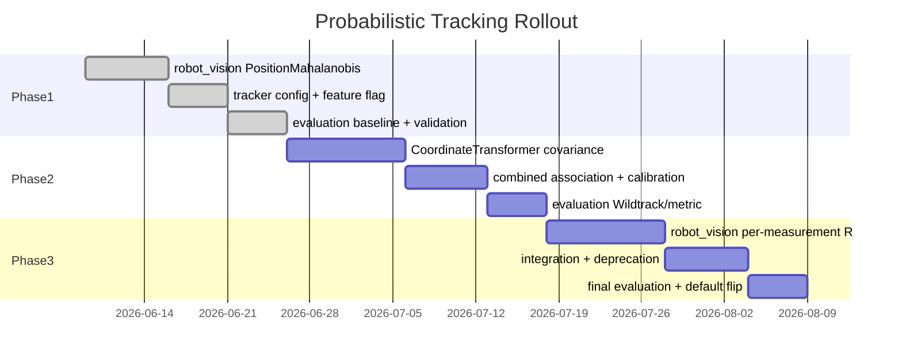

<!--
SPDX-FileCopyrightText: (C) 2026 Intel Corporation
SPDX-License-Identifier: Apache-2.0
-->

# Implementation Plan: Probabilistic Tracking Association

- **Author(s)**: [Sarat Poluri](https://github.com/spoluri)
- **Date**: 2026-06-06
- **Status**: Phase 1 implemented, opt-in (shipped configs use `euclidean`); default flip pending the Wildtrack regression; Phases 2–3 open
- **ADR**: [ADR-0019](../../docs/adr/0019-probabilistic-tracking-association.md)
- **Design**: [Probabilistic Tracking Association](../../docs/design/probabilistic-tracking-association.md)
- **Evaluation**: [ADR-0009](../../docs/adr/0009-tracking-evaluation.md), [Tracker Evaluation Pipeline](../../docs/design/tracker-evaluation-pipeline.md)

This plan tracks **tasks, validation, and exit criteria**. Architecture and design detail live in the ADR and design doc above.

---

## Phase 1 — Track-side position Mahalanobis

**Status:** Implemented and validated as an alternative. The services default to `position_mahalanobis` (0.99, `max_radius_m: 10`) without an `association` block, but the shipped configs select `euclidean` until the Wildtrack regression below is resolved; `controller/config/tracker-config-mahalanobis.json` and `tracker/config/tracker-mahalanobis.json` select Phase 1.

### 1.1 robot_vision

| Task | Location | Notes |
|------|----------|-------|
| Add `DistanceType::PositionMahalanobis` | `ObjectMatching.hpp/.cpp` | 2×2 block on (x,y); 3×3 on (x,y,z) with Z tracking |
| Chi-squared gate helper | `ObjectMatching.cpp` / `Utils.hpp` | `df=2`; `df=3` with Z tracking |
| Keep `max_radius_m` as hard ceiling | `ObjectMatching.cpp` | Independent of χ² |
| Velocity-aligned kinematic process noise | `MultiModelKalmanEstimator.cpp` | Along-track ≫ cross-track Q |
| UKF / IMM association covariance fixes | UKF + IMM | Top-model S; Sxy sigma points; yaw-rate init |
| Unit tests | `TrackingTests.cpp`, `tracking_test.py` | Along-track vs lateral preference |
| Python binding | `tracking.cpp` | Expose enum |

### 1.2 Tracker service

| Task | Location |
|------|----------|
| `AssociationConfig` on `TrackingConfig` | `inc/config_loader.hpp` |
| Schema + defaults | `schema/config.schema.json`, `config/tracker.json` (`euclidean`), `config/tracker-mahalanobis.json` |
| Env var overrides | `inc/env_vars.hpp`, `src/config_loader.cpp` |
| Wire method + gate | `src/tracking_worker.cpp` |
| Remove hardcoded 2.0 m association threshold | `src/tracking_worker.cpp` |

Follow [Tracker Agents.md](../../tracker/Agents.md) config checklist.

### 1.3 Controller

| Task | Location |
|------|----------|
| Read association config | `ilabs_tracking.py` |
| Stop averaging `tracking_radius` for `position_mahalanobis` and for `euclidean` with `max_radius_m`; without it `euclidean` keeps the average, as before | `ilabs_tracking.py` |
| Feature-flag parity with tracker service | controller tracker config JSON (`tracker-config.json` `euclidean`, `tracker-config-mahalanobis.json`) |
| Birth clustering Euclidean ~2 m; equal-weight multi-cam geometry | `MultipleObjectTracker` / fuse path |

### 1.4 Soft deprecation

| Task | Status |
|------|--------|
| Warn once per tracker when `tracking_radius` differs and is ignored (`position_mahalanobis`, or `euclidean` with `max_radius_m`) | Done |
| Document in object library / user guide | Done (`how-to-define-object-properties.md`, `how-to-configure-tracker.md`) |
| Do **not** remove `tracking_radius` DB field in Phase 1 | Held |

### Phase 1 exit criteria

- [x] Feature flag ships; `position_mahalanobis` validated vs Euclidean
- [ ] Evaluation metrics within thresholds on gated datasets: Unity yes; Wildtrack no (Controller-TC and Tracker-Service HOTA −0.02, jerk up), see the validation notes
- [x] CI unit coverage for association wiring
- [x] ADR-0019 → `Accepted` for Phase 1 scope
- [ ] Default flip → `position_mahalanobis` (shipped configs; services already default to it without a block) after the Wildtrack regression is resolved and Controller-TC + Wildtrack re-signoff

### Phase 1 validation notes

Supersedes the earlier sign-off notes, whose artefacts (`/tmp/phase1-*`) are gone and whose Wildtrack gains the current results do not reproduce. Details are in the PR 4 description.

**Accuracy** (Tracker Evaluation black-box harness; `feature/prob-tracking-extracted-association` @ `057d04cf7` vs `main` @ `5ac534ed1`; 3 runs per dataset and side; Controller-Immediate, Controller-Time-Chunking, Tracker-Service). A delta counts only when |Δ| exceeds the min-to-max range of the runs (noise); Wildtrack Tracker-Service is deterministic, so its deltas are exact.

- **Euclidean** (branch, 2 m) matches `main` everywhere: no delta above noise on Unity or Wildtrack, Wildtrack Tracker-Service bit-identical.
- **Unity**: Mahalanobis matches `main` on HOTA, MOTA, IDF1 and location errors; marginal Controller-TC jitter (`rms_jerk` +10–15 %, `acceleration_variance_ratio` +18 %).
- **Wildtrack with Mahalanobis is worse than `main`** on Controller-TC and Tracker-Service, and the regression comes entirely from `position_mahalanobis`:

| Wildtrack | `main` | Mahalanobis | Euclidean |
|-----------|--------|-------------|-----------|
| HOTA, Controller-TC | 0.6473 | **0.6271** | 0.6474 |
| HOTA, Tracker-Service | 0.7643 | **0.7431** | 0.7643 |
| `rms_jerk`, Controller-TC | 2.456 | **2.828** | 2.398 |
| `rms_jerk`, Tracker-Service | 1.814 | **2.671** | 1.814 |

  IDF1 −0.024 / −0.021, Tracker-Service MOTA −0.026, location errors +0.03–0.09 m.
- Controller-Immediate drops 3–7 % of messages on Unity and 35–48 % on Wildtrack on every side; Controller-TC and Tracker-Service drop none.

**Performance** (`main` @ `9aa829b12` vs PR 4 @ `51506dc51`; Euclidean / Mahalanobis):

- robot_vision benchmark (one pinned core, median of 7, 2 passes): Euclidean −0.7 to −1.7 % in all 12 cases with 50 / 200 people; Mahalanobis −0.7 to +2.9 %, and +8.1 % (single-threaded) / +13.0 % (8 cores) with 300 people and 4 overlapping cameras.
- Tracker Service `make test-load` (4 cameras × 15 fps × 300 objects, 1 min): 0 % dropped and 300 tracks on every side; Tracker CPU per run 133.7 s on `main`, −0.3 % Euclidean, +1.3 % Mahalanobis; Track-stage p50 / p99 25.7 / 35.6 ms on `main`, unchanged Euclidean, +4.5 % / +7.4 % Mahalanobis; end-to-end latency within noise. A 10 m Euclidean gate costs +3 % CPU and +12 % Track p50.

**Kept from the earlier notes** (implemented and covered by unit tests, not re-measured): covariance shaping (velocity-aligned coast ellipses) and the cross-camera fixes (Euclidean ~2 m birth clustering, equal-weight geometry average).

---

## Phase 2 — Geometry-derived measurement covariance

**Goal:** See [design §5.3](../../docs/design/probabilistic-tracking-association.md#53-phase-2--geometry-derived-measurement-covariance).

### 2.1 Tasks

| Task | Location |
|------|----------|
| Pixel→world Σ_xy in `CoordinateTransformer` | `tracker/src/coordinate_transformer.cpp` |
| `position_covariance_xy` on `Detection` | `tracker/inc/tracking_types.hpp` |
| Optional `measurementCovariance` on `TrackedObject` | `robot_vision` |
| `DistanceType::PositionMahalanobisCombined` | `ObjectMatching.cpp` |
| `measurement_uncertainty.*` config | schema, loader, controller |
| Calibrate α offline; record default | eval harness + design/plan appendix |

### Phase 2 validation

```bash
cd tracker && make test-unit-coverage
```

- Transformer tests: Σ grows with bbox height, range, lower confidence; Jacobian FD vs analytic
- Matching: combined gate wider at long range
- Eval: metric test + Wildtrack; AssA up, ID switches down, LocA hold/improve

### Phase 2 exit criteria

- [ ] α calibrated and documented
- [ ] `position_mahalanobis_combined` passes evaluation thresholds
- [ ] Per-object `tracking_radius` unused in association paths
- [ ] Optional debug emit of Σ_xy for sampled detections

---

## Phase 3 — Per-measurement UKF update

**Goal:** See [design §5.4](../../docs/design/probabilistic-tracking-association.md#54-phase-3--per-measurement-ukf-update).

### 3.1 Tasks

| Task | Location |
|------|----------|
| `correct(measurement, R_optional)` | `MultiModelKalmanEstimator.*` |
| Thread R onto `TrackedObject` before correct | `tracking_worker.cpp`, `ilabs_tracking.py` |
| Global filter noise knobs in config | schema, loader |
| Deprecate `tracking_radius` in manager + user guide | `manager/`, `docs/user-guide/` |
| (Later) multi-cam class/confidence fusion | `fuseMetadata` |

### Phase 3 validation

- Unit: low R pulls strongly; high R weakly; jerk improves vs Phase 2 on noisy detections
- Eval: LocA/jitter gain; AssA holds vs Phase 2
- Load: `cd tracker && make test-load` — transform+track overhead ≤ 10% vs Phase 1

### Phase 3 exit criteria

- [ ] End-to-end: predict → associate(S_pred + R) → correct(R)
- [ ] `tracking_radius` deprecated in object-library docs
- [ ] Default method → `position_mahalanobis_combined`
- [ ] Metrics meet or exceed Phase 2 on gated datasets

---

## Non-planar Z / `vz` tracking (controller + tracker)

**Status:** Controller + tracker Z/`vz` tracking on `feature/prob-tracking-extracted-3d`. Tracker 3D detection input (`translation` / `size` / `rotation`) came through main (#2050) and is merged.  
**Out of scope here:** mesh/DEM foot-ray for plain 2D cameras (separate PR). Issue 1 from the `vz` review (ground-plane pixel path) stays deferred.

### Shared (`robot_vision`) — done with controller

Tracker builds `controller/src/robot_vision` in-tree (`tracker/CMakeLists.txt`), so these apply on tracker rebuild:

| Item | Detail | Commit / notes |
|------|--------|----------------|
| State `vz` | Layout `[… z, vz, length, width, height, yaw, yaw_rate]`; CV/CA/CTRV integrate `z += vz·dt`; CP zeros `vz` | |
| Process noise | Independent `Q[vz,vz]` | |
| 3D association | Euclidean + `PositionMahalanobis` on `(x,y,z)`; birth cluster Euclidean is 3D | |
| χ² gate | Matching uses `df=3` (~11.34 @ p=0.99); the UI XY ellipse uses the same `df=3` | |
| Named indices | `StateIndex` / `MeasurementIndex` | |
| `isDynamic` | `vx²+vy²+vz² > 1` (vertical counts toward coast aging) | |
| Unit tests | Climb, coast, `|vz|≈0`, stacked-floor association | |

### Controller-only — done (skip for tracker)

| Item | Location |
|------|----------|
| Association params use `chi2_threshold(p, 3)` | `ilabs_tracking.association_match_params` |
| Association window viz uses `chi2_threshold(p, 3)` | `ilabs_tracking.build_association_window` |
| Publish `velocity[2]` from UKF `vz` | `ilabs_tracking` |
| Prefer detection `translation` / 3D bbox Z when present | `moving_object.mapObjectDetectionToWorld` (already) |
| Functional climb via external-source MQTT | `tests/functional/test_z_tracking.py` |

### Tracker service

**Do not re-implement** shared filter/association math; rebuild against updated `robot_vision`.

| # | Task | Location | Status |
|---|------|----------|--------|
| T1 | χ² `df=3` for match cost; `df=3` for the association-window ellipse too | `association_config.hpp`, `association_window.hpp` | Done |
| T2 | Detection `translation` / `size` / `rotation` input, translation path preserves Z | #2050 (through main) | Done |
| T3 | Set `zMeasured = true` on the translation path | `coordinate_transformer.cpp` | Done |
| T5 | Assert published `velocity[2]` / `translation[2]` | `track_publisher_test.cpp` | Done |
| T6 | End-to-end: stacked-floor 3D detections stay separate; climbing 3D detection publishes `translation[2]` / `velocity[2]` | `tracking_worker_test.cpp`, `coordinate_transformer_test.cpp` | Done |

**Still deferred / follow-ups from Z review:**

| # | Item | Notes |
|---|------|-------|
| F1 | 3D detection input (`translation` / `size` / `rotation`, bbox-less detections) | **Done:** #2050. |
| F2 | Wildtrack (planar) eval after χ² `df=3` | Gate loosened ~9.21→11.34 at p=0.99 for planar scenes. **Run Wildtrack eval; mitigate from results** (do not pre-mitigate). |
| F3 | Ingest 3D detection `rotation` into tracker / UKF yaw | **Done:** #2050. |
| F4 | Size for 3D detections | **Done:** #2050 requires `size` with `translation`. |
| F5 | Mesh / DEM foot-ray for bbox-only cameras | Separate PR. |
| F6 | Schema `distance` alone without `translation` | Deferred. |
| F8 | One z reference for pixel (ground point) and 3D (box centre) detections | **TODO:** a mixed track publishes a midpoint height, splits on a camera → 3D handover at ≥ ~2 m centre height, and gets spurious `vz` when sensors alternate. |
| F7 | Hybrid birth: `EuclideanBirth` + `zMeasured` | **Done:** XY if either planar; XYZ when both measured. Revisit after metrics. Tracker sets `zMeasured` on translation detections (T3). |

**Birth clustering note (not association default):** Unmatched detection→detection fusion uses `DistanceType::EuclideanBirth` ~`kDefaultBirthClusterRadiusM` (2 m), even when track→detection association is `position_mahalanobis`. Raw detections lack `predictedMeasurementCov`, so Mahalanobis cannot birth-cluster. `EuclideanBirth` is XY when either side lacks `zMeasured` (planar + 3D OD still fuse); XYZ when both have measured Z (stacked floors stay separate). Revisit after metrics / multi-floor datasets.

### Tracker validation

```bash
cd tracker && make test-unit test-robot-vision
```

---

## Rollout checklist

1. [ ] Phase 1 default flip (`position_mahalanobis`): shipped configs stay `euclidean`, with Mahalanobis alternative configs, until the Wildtrack regression is resolved
2. [ ] Phase 2 opt-in combined; default stays Phase 1 until sign-off
3. [ ] Phase 3 default flip to combined
4. [x] Controller non-planar Z/`vz` + 3D association
5. [x] Tracker χ² df=3 parity + `vz` publish tests
6. [ ] F2: Wildtrack eval post–χ² df=3; mitigate from results
7. [x] F1: Tracker 3D detection input (#2050) + `zMeasured` (T3)
8. [x] F7: Hybrid birth clustering (`EuclideanBirth` / `zMeasured`)
9. [ ] F8: One z reference for pixel and 3D detections



---

## File touch list

| Component | Phase 1 | Phase 2 | Phase 3 |
|-----------|---------|---------|---------|
| `robot_vision/ObjectMatching.*` | ✓ | ✓ | |
| `robot_vision/TrackedObject.*` | | ✓ | ✓ |
| `robot_vision/MultiModelKalmanEstimator.*` | ✓ | | ✓ |
| `tracker/coordinate_transformer.*` | | ✓ | |
| `tracker/config_loader.*`, schema | ✓ | ✓ | ✓ |
| `tracker/tracking_worker.cpp` | ✓ | ✓ | ✓ |
| `controller/ilabs_tracking.py` | ✓ | ✓ | ✓ |
| `controller/config/`, `tracker/config/` (shipped and Mahalanobis configs) | ✓ | | |
| `scene_common/association.py` | ✓ | | |
| `manager/models.py` (deprecation) | | | ✓ |
| `tools/tracker/evaluation/` | ✓ | ✓ | ✓ |
