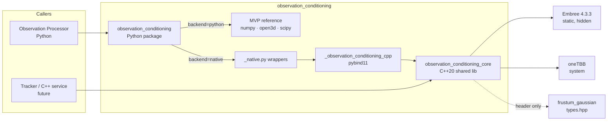

<!--
SPDX-FileCopyrightText: (C) 2026 Intel Corporation
SPDX-License-Identifier: Apache-2.0
-->

# Design Document: Observation Conditioning in C++

- **Author(s)**: Tomasz Dorau
- **Date**: 2026-11-26
- **Status**: `Proposed`
- **Related ADRs**: [ADR-0019 — Probabilistic Tracking Association](../adr/0019-probabilistic-tracking-association.md), [ADR 13 — Controller Breakdown into Microservices](../adr/0013-controller-breakdown-microservices.md)
- **Plan**: [plan-observation-conditioning-cpp-port.md](../../.github/plans/plan-observation-conditioning-cpp-port.md) (ITEP-98737). The plan holds the MVP analysis, the porting challenges (C1–C7), the decisions (D1–D4) and the terminology.

---

## 1. Overview

This document describes the C++20 re-implementation of the `observation_conditioning` library (`AmodalReasoner`, `DepthMap`) and its Python bindings.

- C++ services such as the Tracker can link the library directly.
- The Observation Processor (OP) keeps calling the same Python API, now backed by native code.
- The Python MVP stays in the package as the reference backend and the fallback.

| Doc | Owns |
| --- | --- |
| This doc | C++ architecture, API, numerics, parallelism, packaging, test strategy |
| [Plan](../../.github/plans/plan-observation-conditioning-cpp-port.md) | Scope, decisions, work breakdown, evaluation |
| [Algorithm notes](../../spatial_performance_primitives/observation_conditioning/amodal_reasoner_algorithm.md) | Math. It is not restated here. |
| [implementation.md](../../spatial_performance_primitives/observation_conditioning/implementation.md) | What the port drops from the original MVP |
| [OP design](../observation-processor-service.md) | Service modes, caching, gRPC. This doc only changes how the service builds and selects the library. |

## 2. Goals

- **G1. Native library.** The C++ library has no Python or Open3D dependency. It can be linked by the Tracker or any C++20 service.
- **G2. Aligned with `frustum_gaussian`.** It uses the `fg` naming, POD-struct and pointer + count batch conventions, takes `fg::FrustumObservation` as input, and uses the same build tooling.
- **G3. Drop-in Python API.** The OP and its tests run unchanged against the native backend (C3).
- **G4. Numerical parity with the cleaned MVP (D1, D4).** Per-object decisions are identical, and continuous outputs agree within the tolerances in §5.5.
- **G5. Faster.** The native backend is faster than the MVP and scales with cores and ISA, without oversubscribing a host process.
- **G6. Tested.** C++ line coverage ≥ 90%, Python ≥ 90%, a service harness, and benchmarks.

## 3. Non-Goals

- Algorithm changes or behavior fixes (I4–I6, I8, I9). These are follow-ups (D1). The I1–I3 and I7 cleanup is done in the MVP before the port (D4).
- GLB or mesh-file loading. The library takes vertex and index arrays (D2, option A). A C++ loader is a follow-up (option B).
- In-process Tracker integration itself. This doc only makes it possible.
- GPU (SYCL) bake or dynamic meshes. They are future work (C7).

## 4. Background / Context

The MVP (Python, Open3D 0.19, SciPy) is analyzed in [Plan → MVP](../../.github/plans/plan-observation-conditioning-cpp-port.md#mvp).

- **Cost.** `generate` costs about 0.7 ms plus about 37 µs per object, almost all Python and NumPy overhead. The bake costs 210 ms at 1080p with L=1.
- **Parity anchors** (C1). Open3D ray casting is Embree 4.3.3 with the ROBUST flag and `rtcIntersect1`. The truncated-normal moments come from SciPy's log-space algorithm.

## 5. Proposed Design

### 5.1 Package layout

The package moves to the `frustum_gaussian` layout with `git mv`, so history is kept:

```text
spatial_performance_primitives/observation_conditioning/
├── cpp/
│   ├── CMakeLists.txt              # options: OC_BUILD_TESTS, OC_BUILD_BENCHMARKS, OC_NATIVE_ARCH, OC_EMBREE_SOURCE
│   ├── cmake/embree.cmake          # pinned Embree 4.3.3 source build (§5.7)
│   ├── include/observation_conditioning/
│   │   ├── types.hpp               # CameraModel, MeshView, ConditionedDepth, DecisionTrace, options, Status
│   │   ├── constants.hpp           # inline constexpr mirror of constants.py
│   │   ├── device.hpp              # oc::Device (Embree device handle)
│   │   ├── scene_geometry.hpp      # oc::SceneGeometry (mesh → BVH, shareable)
│   │   ├── depth_map.hpp           # oc::DepthMap (bake, query, cast)
│   │   └── amodal_reasoner.hpp     # oc::AmodalReasoner (condition)
│   ├── src/                        # *.cpp, detail/truncnorm.{hpp,cpp}, detail/camera_math.hpp
│   ├── python/bindings.cpp         # _observation_conditioning_cpp
│   ├── tests/                      # gtest unit + corpus regression
│   └── benchmarks/                 # Google Benchmark
├── python/observation_conditioning/
│   ├── __init__.py                 # lazy exports, backend selection (§5.6)
│   ├── constants.py                # single source of tuning values (D4)
│   ├── amodal_reasoner.py          # MVP reference backend (cleaned)
│   ├── intersection_map.py         # MVP reference DepthMap
│   └── _native.py                  # drop-in wrappers around the extension
├── tests/                          # pytest: unit, parity, regression, baseline tools
│   └── data/                       # frozen baselines (.ocb, §5.9)
├── conanfile.txt  pyproject.toml  Makefile  Dockerfile.test  tests/requirements.txt
└── README.md  AGENTS.md  implementation.md  amodal_reasoner_algorithm.md
```

The Python import root becomes `observation_conditioning/python`, as it already is for `fg`. The service Dockerfile, the root `Makefile` (`SPATIAL_PERFORMANCE_*`, `COMPLEXITY_SOURCES`) and the OP test `conftest.py` are updated to match.

### 5.2 Components



| C++ type | Responsibility | Lifetime and threading |
| --- | --- | --- |
| `oc::Device` | Owns the `RTCDevice`. Config: max ISA (`auto` or `avx2` for parity), build threads. | Shared via `shared_ptr`. `Device::default_instance()` is lazily created and thread-safe. |
| `oc::SceneGeometry` | Copies the mesh (float32 vertices, uint32 indices), validates it, and builds the Embree scene with `RTC_SCENE_FLAG_ROBUST` and the default build quality, committed eagerly. | Immutable after construction. Shared by all `DepthMap`s of a scene (one BVH per mesh, where the MVP builds one per camera). Thread-safe queries. |
| `oc::DepthMap` | Bakes the per-pixel range (`t_hit`) and normal maps with L peeled layers. Provides `query` (world points → map lookups) and `cast` (arbitrary rays). | Immutable after the bake. Thread-safe. |
| `oc::AmodalReasoner` | Holds world-up and a `DepthMap`. `condition()` is the C++ form of `generate`. | Immutable. `condition()` is `const`, re-entrant and allocation-free per object. |

All classes are move-only. They use the pimpl idiom, so public headers include no Embree, Eigen or TBB headers, and consumers need only `fg/types.hpp` and the standard library.

### 5.3 C++ API (namespace `oc`)

```cpp
namespace oc {

// --- inputs ---------------------------------------------------------------
struct MeshView {                        // world frame, static (AGENTS invariants 1–2)
    std::span<const float>    vertices;  // 3·V, xyz
    std::span<const uint32_t> indices;   // 3·T
};

struct CameraModel {
    std::array<double, 9>  K;            // 3×3 row-major pinhole (a 3×4 K is trimmed by the caller)
    std::array<double, 16> pose;         // 4×4 row-major camera→world (same layout as fg pose_mat)
    uint32_t width = 0, height = 0;
    // Optional exact inverses (row-major). The bindings fill them from numpy
    // (np.linalg.inv) for bit parity with the MVP; otherwise they are computed in C++.
    std::optional<std::array<double, 9>>  K_inv;
    std::optional<std::array<double, 16>> pose_inv;

    static CameraModel from_fg(const fg::Intrinsics&, const float pose_mat[16]);
};

struct DepthMapOptions {
    uint32_t  num_layers = 1;            // D4: default 1 (peeling kept)
    Traversal traversal  = Traversal::Single;  // Single = rtcIntersect1 (parity); Packet8 or Packet16 after verification
    size_t    max_map_bytes = 0;         // 0 = unlimited; guard for W·H·L·16 B
};

struct ExecutionOptions {
    int    max_threads        = 0;       // 0 = TBB default; >0 runs in a tbb::task_arena (no oversubscription in a host)
    size_t parallel_threshold = 64;      // run condition() in parallel only for N ≥ threshold (as fg)
};

// --- outputs --------------------------------------------------------------
struct ConditionedDepth { double depth; double variance; };   // along ray; float64 as in the MVP

enum DecisionFlags : uint16_t {
    FREE_3D = 1 << 0, OCCLUDED = 1 << 1, WALL_VERTICAL = 1 << 2, WALL_SPECTRUM = 1 << 3,
    TOTAL_OCCLUSION = 1 << 4, WALL_DROPPED_AS_OCCLUDER_FACE = 1 << 5,
    EMPTY_INTERVAL = 1 << 6, UPDATED = 1 << 7,
};
struct DecisionTrace {                   // optional, per call (no instance state)
    uint16_t flags;
    double   occlusion_depth, wall_depth;     // NaN when absent
    double   total_occlusion_fraction;
    double   alpha, beta, sigma_pre;          // truncation inputs (NaN when not updated)
};

enum class Status : uint8_t { Ok, InvalidArgument, NonFiniteInput };

// --- classes --------------------------------------------------------------
class SceneGeometry {
public:
    static std::shared_ptr<const SceneGeometry> create(
        const MeshView&, std::shared_ptr<Device> = Device::default_instance());  // throws std::invalid_argument / std::runtime_error
};

class DepthMap {
public:
    DepthMap(std::shared_ptr<const SceneGeometry>, const CameraModel&,
             const DepthMapOptions& = {}, const ExecutionOptions& = {});        // bakes; throws on invalid input
    // t_hit: n·L (inf = miss/out-of-frame); normals: n·L·3 (NaN = miss)
    void query(const double* world_xyz, size_t n, double* t_hit, double* normals) const noexcept;
    // origins: n·3, or 3 values when broadcast_origin; t_hit: n (inf = miss); normals: n·3 (0 = miss, as Open3D)
    void cast(const float* origins, bool broadcast_origin, const float* dirs, size_t n,
              float* t_hit, float* normals) const noexcept;
    std::span<const float> t_hit_map()  const noexcept;  // H·W·L, C-order (y, x, layer)
    std::span<const float> normal_map() const noexcept;  // H·W·L·3
    uint32_t width() const noexcept; uint32_t height() const noexcept; uint32_t layers() const noexcept;
    const CameraModel& camera() const noexcept;
};

class AmodalReasoner {
public:
    AmodalReasoner(std::shared_ptr<const SceneGeometry>, const CameraModel&,
                   const std::array<double, 3>& world_up,
                   const DepthMapOptions& = {}, const ExecutionOptions& = {});
    // obs: world-frame fg observations (after fg::transform_to_world). Only ray, Sigma,
    // depth_est and depth_hi are read; fg's mu (the centroid) is NOT used as the ray origin.
    // origins: optional n·3 per-row ray origins (nullptr = camera origin); used by the
    // Python binding to keep the MVP dict "mu" semantics.
    Status condition(const fg::FrustumObservation* obs, size_t n, ConditionedDepth* out,
                     DecisionTrace* trace = nullptr, const double* origins = nullptr) const noexcept;
    const DepthMap& depth_map() const noexcept;
};

}  // namespace oc
```

**Design notes**

- **Error model.** Construction can fail (empty or out-of-range mesh, singular K, non-rigid pose, zero W×H, map over budget, Embree errors) and throws `std::invalid_argument` or `std::runtime_error`, as the Tracker code already does. The hot path is `noexcept` and returns `Status`:
  - Null pointers with n > 0 → `InvalidArgument`.
  - A non-finite or zero-length ray, a non-finite `depth_est`, `Sigma` or origin → `NonFiniteInput`, and the outputs are left untouched.
  - The MVP returned NaN in these cases, and the OP turned it into `ValueError`, so the service behavior does not change.
  - `depth_hi = ±inf` stays valid input, as in the MVP.
  - `n = 0` → `Ok`.
- **`fg` alignment** (C4). The library uses the `fg` input struct, row-major arrays and the `pose_mat` layout, and the pointer + count batch call with caller-allocated output. The only intentional difference is that outputs are float64, because the MVP returns float64 and parity requires it. It depends only on `fg`'s `types.hpp`; there is no link dependency.
- **Shared BVH.** `SceneGeometry` lets N cameras of one scene share one BVH. The Python drop-in keeps one geometry per reasoner, as the MVP does. The service can opt in later through a `SceneGeometry` Python object without API breakage.

### 5.4 Algorithm mapping

`condition()` executes the cleaned MVP pipeline (Plan → MVP → Effective pipeline, minus I1 and I2) for each object, in a fixed order. There are no batched temporaries. Each object needs 27 depth-map lookups (5 + 5 probes, 8 spectrum, 9 column) and one truncated-normal evaluation.

| MVP function | C++ | Notes |
| --- | --- | --- |
| `_build_orthonorm_frame`, `_deconstruct_cov` | `detail::ray_frame` | The degenerate-axis fallback is kept (1e-6). |
| `_create_probe_points` (2.0σ, 2.1σ) | `detail::probes` | `e_v` is oriented to world-up. |
| `DepthMap.query` | `DepthMap::query` | Uses `pose_inv`, then K, then perspective divide, then `std::nearbyint` (half-to-even) and the in-frame and `z > 0` checks. |
| `_get_free_3d_mask` | inline | Lower probe, layer 0. |
| `_get_occlusion_depth` (naive) | inline | Uses `std::fmin` and explicit NaN masks. |
| `_signed_wall_angle`, `_wall_spectrum`, `_get_wall_depth` (cleaned) | `detail::wall` | Signed band [75°, 115°); 8-ray spectrum with unsigned 75° and 0.1 m rise. |
| `_total_occlusion` | `detail::total_occlusion` | 9 targets; frac ≥ 0.9; 0.1 m margin. |
| `_update_depth_gaussian` + `truncnorm.stats` | `detail::update`, `detail::truncnorm_mv` | Port of SciPy's algorithm (§5.5). |

The constants come from `constants.hpp`, which mirrors `constants.py` one-to-one. A Python test asserts equality through the binding.

### 5.5 Numerics and parity contract

- **Dtype-faithful.** Each expression is evaluated at the precision NumPy uses for it under NEP 50 promotion: float32 where the MVP is float32 (for example the normalized ray `e1`, peeling arithmetic, ray-cast inputs), float64 elsewhere. The casts to float32 happen at the same points as in the MVP.
- **Compiler flags.** `-fno-fast-math -ffp-contract=off`, and no `-march=native` by default. The ISA comes only from Embree's runtime dispatch.
- **Ray casting** (C1). Embree 4.3.3, `RTC_SCENE_FLAG_ROBUST`, `tnear=0`, `tfar=inf`, `rtcIntersect1`, and normals = the normalized `Ng`.
  - Miss conventions: `cast` returns 0 normals; the bake and `query` return NaN normals and inf `t_hit`.
  - Peeling uses the float32 nudge `t_total + 1e-4`, as in `_peel_rays`.
- **Truncated normal** (`detail::truncnorm_mv`) ports `scipy.stats.truncnorm._stats`:
  - The log mass uses the left, right and central cases.
  - `log_ndtr(x)` is `log1p(-erfc(x/√2)/2)` for x ≥ −1, `log(erfc(−x/√2)/2)` down to the erfc underflow, and an asymptotic series below that.
  - The variance uses the stable form `1 + (a−μ)pA − (b−μ)pB`, with the `±inf` guards.
  - The MVP's empty-interval fallback (midpoint, inflated variance) is kept.
  - It is validated against SciPy on a dense grid that includes ±inf and tails to |x| = 1e3.
- **Tolerances** (Phase 4 confirms them, Phase 5 reports them):

| Quantity | Target |
| --- | --- |
| Per-object decision flags | Identical. A flip is allowed only where the MVP's decision margin is within 1e-6 relative of its threshold; the test computes that margin. |
| `updated_depth`, `updated_var` | rtol 1e-6, atol 1e-9 when the decisions match |
| `t_hit` maps vs Open3D | ≤ 4 float32 ULP, with ≥ 99.99% of pixels exactly equal |
| `truncnorm_mv` vs SciPy | rtol 1e-12 |

- **Inverse matrices.** NumPy's `inv` (LAPACK) and Eigen's differ by ULPs. Ray directions and pixel rounding depend on them, so the binding passes `K_inv` and `pose_inv` from NumPy. Standalone C++ computes them itself and is checked with tolerance only.
- **Precision of origins.** Parity is bit-faithful for the OP contract: `mu` is the float64 camera origin and the other fields are float32. With other dtype mixes (for example a float32 `mu` in library tests), outputs are equal within the tolerances.

### 5.6 Python package and drop-in

- **Backend selection.** `observation_conditioning.AmodalReasoner` and `observation_conditioning.DepthMap` resolve lazily to `_native` or to the reference classes.
  - The env var `OBSERVATION_CONDITIONING_BACKEND` takes `auto` (default: native if importable, else reference with a single warning), `native` (an import error is fatal) or `python`.
  - `observation_conditioning.backend()` reports the active backend.
  - Open3D is still not imported at package import (AGENTS invariant 8).
- **Wrappers in `_native.py`.** They are plain Python classes holding the native object, so `patch.object` works (C3). They keep the MVP constructor signatures, attributes and dtypes:
  - `AmodalReasoner(mesh, rwc_z_up, camera_intrinsics, camera_extrinsics, width, height, num_layers=1)`.
    - `mesh` is duck-typed: an Open3D tensor mesh (`vertex.positions`, `triangle.indices`), a `SceneGeometry`, or a `(vertices, indices)` pair.
    - `generate(gaus_rays)` returns `(depth, var)` as float64 arrays of shape `(N,)`, with the GIL released.
    - `depth_map`, `rwc_z_up`, `mesh`, `debug`/`trace` are kept. The native `trace` holds the per-call `DecisionTrace` as arrays, not the MVP's geometry dumps.
  - `DepthMap(camera_intrinsics, camera_extrinsics, mesh, width, height, num_layers=1)` keeps the explicit `populate()`.
    - `query()` returns float64 arrays.
    - `cast_np(dir_vecs, origin=None)` returns `(normals, t_hit)` as float32, with 0 normals on a miss.
    - `t_hit_map` and `normal_map` are zero-copy, read-only NumPy views that keep the native object alive. Their shapes are `(H, W)` and `(H, W, 3)` when L = 1, otherwise `(H, W, L)` and `(H, W, L, 3)`.
- **Exceptions.** `std::invalid_argument` and `Status::{InvalidArgument, NonFiniteInput}` become `ValueError`; `std::runtime_error` becomes `RuntimeError`.
- **Service changes.** The Dockerfile builds and installs the wheel, the import root path changes, and `DEFAULT_NUM_LAYERS = 1` (D4). There are no logic changes. Rollback is `OBSERVATION_CONDITIONING_BACKEND=python`.

### 5.7 Parallelism, HW scaling, build and packaging

- **Bake.**
  - `tbb::parallel_for` runs over `blocked_range2d` tiles of 16×16 pixels. Pixel→ray generation is fused into the tile loop, so there are no H×W×3 float64 temporaries and no retained pixel grid.
  - Output is written directly into C-order maps.
  - `Traversal::Packet8` and `Traversal::Packet16` (coherent 4×2 or 4×4 pixel packets) are available behind an option. They become the default only if the corpus shows results identical to `rtcIntersect1` (C7).
- **`condition()`.** It runs serially below `parallel_threshold` and with TBB `parallel_for` above it. It writes no shared state and does no per-object heap allocation. The bindings release the GIL, so the 4 gRPC workers run concurrently.
- **Threading runtime, decided (D8): oneTBB.** This is the same runtime as `fg`. The Tracker and robot_vision use OpenMP today; they move to oneTBB in follow-ups, so the end state has one runtime per process. The follow-ups are ordered so a mixed TBB + OpenMP Tracker process never ships (§8).
- **No oversubscription.** With `ExecutionOptions::max_threads > 0`, the bake and `condition()` run in a `tbb::task_arena`. `Device` takes Embree `threads=` for the BVH build.
- **Intel HW hooks** (C7):
  - Embree is built with SSE4.2, AVX2 and AVX-512 kernels and dispatches at runtime, so Xeon uses AVX-512 (Open3D's build caps at AVX2). `Device` accepts `isa=avx2` for parity runs.
  - icpx multi-ISA builds (`-ax`) are supported by the CMake, as in `fg`.
  - Hybrid P/E-core placement is a documented extension point: `ExecutionOptions` can grow oneTBB core-type constraints. It is not implemented in this ticket.
- **Embree sourcing (C5), decided (D5).** `cmake/embree.cmake` does an `ExternalProject` build of the pinned 4.3.3 release tarball (SHA256-checked) as a **static, PIC, `EMBREE_TASKING_SYSTEM=INTERNAL`** library with only triangle geometry. This is the Open3D configuration plus AVX-512.
  - It is linked privately with `-Wl,--exclude-libs,ALL` and hidden visibility, so it cannot clash with Open3D's own static Embree in the same Python process.
  - It does not bring a second TBB. Conan's `embree/4.3.3` forces TBB tasking and pulls in conan's `onetbb/2021.12`, next to the system `libtbb12` that `fg` uses: two different builds with the same soname in one process.
  - `OC_EMBREE_SOURCE=SYSTEM` (for example Ubuntu 24.04's `libembree-dev` 4.3.0) is allowed for local development only, and parity is not guaranteed with it.
- **Other dependencies.**
  - TBB: system oneTBB, the same as `fg` (`libtbb12` is already in the OP runtime image).
  - Eigen 3.4: private, for small linear algebra.
  - pybind11 3.0.4 and scikit-build-core 1.1.2 (pinned as in `fg`).
  - gtest and Google Benchmark, for tests only: Debian packages in the test container, conan elsewhere.
- **C++ standard.** C++20, set by the `OC_CXX_STANDARD` cache variable (default 20), the same as `fg`, the Tracker and robot_vision. C++23 (`std::expected`, `std::mdspan`) is revisited when common-base moves to GCC 14. The OP runtime ships GCC 12's `libstdc++`, so a GCC 14 build would not load there.
- **Toolchain.** GCC ≥ 12.2 (common-base) and GCC 13/14. The wheel is built for the image interpreter (Python 3.11).
- **CMake install.** It exports `observation_conditioningConfig.cmake` with the target `oc::observation_conditioning`, for the Tracker.

### 5.8 Threading model

**Principle:** construct once, then share immutable objects. All parallelism lives inside a library call. When a call returns, no library work is still running and no library thread holds a reference to caller memory.

#### Threads involved

| Thread kind | Created by | Lifetime | Runs |
| --- | --- | --- | --- |
| **Caller threads** | The host. OP: 4 gRPC `ThreadPoolExecutor` workers (requests) plus the `readiness-monitor` daemon thread (`SceneProvider.warm()`, which builds reasoners). Tracker (future): one worker `std::thread` per scope. | Host-defined | Every API call. Serial work runs here; a caller thread also participates in its own TBB `parallel_for`. |
| **TBB worker pool** | oneTBB, lazily on the first parallel algorithm. Process-global and shared with `fg` (the same `libtbb12`). | Until process exit. Workers sleep when idle after a short spin. | `parallel_for` bodies: bake tiles, and `condition()` objects when N ≥ threshold. |
| **Embree build threads** | The `oc::Device` (internal tasking, D5). They are not TBB threads. | Until the device is released. The default device lives for the whole process; threads sleep when idle. | The BVH build inside `rtcCommitScene`, in `SceneGeometry::create` only. |

The pool sizes default to the CPUs in the process affinity mask. CPU quotas (for example `docker --cpus`) may not be reflected, so hosts with quotas set `ExecutionOptions::max_threads` and the `Device` `threads=` setting.

#### What runs in parallel

| Call | Parallel work | Synchronization |
| --- | --- | --- |
| `SceneGeometry::create` | The BVH build runs on the Embree build threads while the caller blocks. The commit is **eager**, in the factory. Open3D commits lazily on the first query instead, which concurrent first queries could race on. | Returns after the commit completes. The geometry is immutable from then on. |
| `DepthMap` constructor (bake) | `parallel_for` over 16×16 pixel tiles. Each tile generates its rays, calls `rtcIntersect1` per pixel (peeling layers sequentially per pixel), and writes its own pixels' map slots. | No locks or atomics: tiles write disjoint memory. The only barrier is the implicit join at the end of `parallel_for`. |
| `AmodalReasoner::condition` | N < `parallel_threshold` (64): serial on the caller thread, which is typical. N ≥ 64: `parallel_for` over objects, each reading the immutable map and writing only `out[i]` and `trace[i]`. | No locks or atomics. There is an implicit join; the output is complete on return. |
| `DepthMap::query`, `DepthMap::cast` | Serial on the caller thread. N is the number of detections, and each lookup or ray is µs-scale. | Read-only. |

**Concurrent calls.** Any number of caller threads may call `condition`, `query` and `cast` on the same or different objects at once. They only read immutable data. Committed Embree scenes are safe for concurrent `rtcIntersect1`. Parallel parts of concurrent calls share the single TBB pool, so the total thread count stays at about the pool size plus the callers; it does not multiply as OpenMP teams would.

#### Shared resources and ownership

| Resource | Shared by | Mutability | Protection |
| --- | --- | --- | --- |
| `oc::Device` (`RTCDevice`, build threads) | All geometries | Internal only (the Embree scheduler) | `shared_ptr`. `default_instance()` is a function-local static, so initialization is thread-safe. |
| `SceneGeometry` (owned vertex and index copies, BVH) | All `DepthMap`s of a mesh | Immutable after `create` | `shared_ptr<const>` with an atomic reference count. The last owner frees it. |
| `DepthMap` maps (`t_hit`, normals) | All callers of a reasoner, and NumPy views | Immutable after the bake | Read-only. NumPy views hold a reference to the owner, so they can outlive the Python wrapper. |
| `AmodalReasoner` (world-up, options) | All callers | Immutable | No member state is written after construction. The decision trace is per call (I9 avoided). |
| `tbb::task_arena` (only when `max_threads > 0`) | All calls on that object | TBB-internal | It is owned by the object and is thread-safe to `execute()` from many threads. |
| TBB worker pool | `oc`, `fg`, and later the Tracker (D8) | TBB-internal | Global work-stealing scheduler. |

**Publication and replacement.** Objects are fully built before the caller publishes them. The OP publishes under `SceneProvider._lock` when it swaps in a new snapshot, which gives the required happens-before ordering. When a mesh or camera changes, a new reasoner is built on the `readiness-monitor` thread while requests keep using the old one. In-flight calls hold references (the Python reference count, or `shared_ptr`), so the old object is freed only after its last call returns. There is no use-after-free and no lock on the request path.

#### Python and the GIL

The bindings convert inputs to contiguous arrays and allocate outputs **while holding the GIL**. They then release it (`py::gil_scoped_release`) for the compute and reacquire it to return. Released-GIL code touches no Python objects. During a request, the 4 gRPC workers therefore run truly concurrently, and a bake on `readiness-monitor` does not block them.

#### Errors, cancellation and determinism

- The hot path is `noexcept`, so no exception crosses a parallel region. In the bake, Embree errors are reported through the device error callback, recorded, and thrown on the caller thread after the join. TBB cancels the remaining tiles if a body throws.
- No reductions are done across threads. Each output element is computed by exactly one thread with a fixed operation order, so **results are bit-identical regardless of thread count or scheduling**. Parity and regression tests depend on this, and a test asserts it.
- **Not fork-safe after first use.** The TBB and Embree threads don't survive `fork()`. Hosts must not fork after creating library objects; the OP does not fork.

#### Contention scenarios

- **Requests during a bake** (OP refresh): bake tiles and the requests' parallel parts share the pool fairly. If warm-up must not affect request latency, give the bake `max_threads` (its own arena), and cap the `Device` build threads.
- **Many-camera warm-up:** building reasoners sequentially on one thread, each with a parallel bake, saturates the machine without oversubscribing it. Sharing one `SceneGeometry` per mesh avoids repeated BVH builds.
- **Tracker (after D8):** per-scope worker threads call `condition()`. Small batches stay serial on the worker; large ones join the shared pool, the same pool as the migrated robot_vision loops. That gives one scheduler per process, and hybrid-core or NUMA constraints can be applied per arena.

### 5.9 Test architecture

| Layer | Content | Gate |
| --- | --- | --- |
| **Frozen baselines** | A generator builds the scenario corpus. Synthetic meshes as code: floor, occluder, wall, occluder-face wall, full column, slope, degenerate up-ray, 3×4 K, behind and out of frame, peeled, mixed winding. Plus the rolling-terrain GLB, converted to arrays. Seeded random and threshold-edge observations. It stores mesh, camera, inputs, outputs, decisions and map samples in a small `.ocb` container: named typed arrays, written in Python, read by a test-only C++ reader. | `mvp-original.ocb` comes from commit `5cc7f08a8`. The cleaned MVP reproduces it bit-exactly (the baseline also stores the decisions), so it is the single baseline. |
| **C++ unit (gtest)** | Camera math and rounding; bake, peel, query, cast and miss conventions; each pipeline stage; `truncnorm_mv` against a SciPy grid fixture; errors (empty, invalid indices, singular K, zero size, budget, null pointers, non-finite input); concurrency (many threads compared to serial); determinism (bit-identical output for 1 and P threads); the TBB path (N ≥ threshold); `max_threads` arena; constants. | Line ≥ 90%, branch ≥ 50% (gcovr, as in `fg`) |
| **C++ regression** | Corpus vs `mvp-original.ocb` | §5.5 tolerances |
| **Python unit** | Wrapper API, dtypes and shapes, `t_hit_map` view lifetime, `patch.object`, backend selection, error mapping, GIL release (threaded smoke test), constants parity | ≥ 90% (pytest-cov) |
| **Python parity** | Reference vs native on the corpus, plus seeded fuzzing, with decision-aware comparison. The existing library and OP unit suites run once per backend. | §5.5 tolerances |
| **Service harness (D3)** | In-process gRPC: `create_server(ObservationProcessorServicer(provider))` on an ephemeral port. Real `fg` projection and a real mesh (terrain); FULL, AUTO and FRUSTUM_ONLY with `project_to_map`. The same requests run per backend and the responses are compared field by field. | Statuses and depth sources identical; numbers within §5.5 |
| **Performance** | Google Benchmark: bake {720p, 1080p, 4K} × L {1, 4} × {toy, terrain} × traversal; `condition` N ∈ {1, 16, 64, 256, 1024} × threads. A Python script compares the backends through the public API, plus the harness's per-request latency. | Reported in Plan → Evaluation |

#### Test environments (reproducibility)

| Environment | Used for | Definition |
| --- | --- | --- |
| **Python venv, pinned** | Library Python unit, parity and regression tests; baseline and fixture generation; the Python backend benchmark | `tests/requirements.txt` in the package. Pinned to the OP runtime versions: `numpy==2.2.6`, `scipy==1.17.1`, `open3d-cpu==0.19.0`, plus `pytest` and `pytest-cov`. Created by `make venv` (gitignored `.venv`). The native wheel is installed into it by `make build-python`. Baseline metadata records the interpreter and package versions. |
| **Repo test venv** (`tests/.venv`) | The OP unit suites per backend, and the service harness (`make run_sscape_unit_suite`) | Existing `tests/requirements.txt` (already pins open3d 0.19.0 and scipy 1.17.1). The native wheel is built and installed with a stamp file, following the existing robot_vision `RV_BUILD_STAMP` pattern. |
| **Dedicated test container** | Everything that needs system dependencies: the C++ build with the pinned Embree source build, gtest, gcovr coverage, Google Benchmark, and the authoritative Python 3.11 parity and harness runs | `Dockerfile.test` in the package. It is based on `intel/scenescape-common-base` (Debian 12, GCC 12.2, Python 3.11, the same as the OP builder), adds the system TBB, gtest and Google Benchmark (Debian packages) and the Open3D runtime libraries, plus pinned `scikit-build-core`, `pybind11` and `gcovr` in `/opt/venv`, and is built through the package `Makefile` (`make test-container`, `make test-in-container`). The CI workflow (D6) uses the same image. The local machine has no Python 3.11, so the container is the reference environment. The local venv is for fast iteration only. |

Performance runs record the host CPU, core count, ISA, the container image digest and the library versions next to every number in Plan → Evaluation.

## 6. Alternatives Considered

| Alternative | Why not |
| --- | --- |
| Link Open3D C++ | Large dependency for one class; heavy build; Open3D in the Tracker |
| Custom BVH, or nanort / tinybvh | Parity risk at triangle edges vs Embree; no Intel ISA tuning |
| Conan `embree/4.3.3` | Forces TBB tasking and conan `onetbb` (a second TBB in the process, see §5.7) |
| Embree 3 (bookworm apt) | Different API and not Open3D's version, so no parity |
| Vectorize NumPy and keep Python | `generate` stays overhead-bound and is not linkable from C++ (G1) |
| Pybind class as the public type | `patch.object` on instances fails, which breaks OP tests (C3) |
| Approximate truncated normal (naive closed form) | NaN in the tails (β ≪ 0), no SciPy parity |

## 7. Risks and Mitigations

- **Discrete decision flips** from ULP differences → decision trace, margin-aware assertions, NumPy-supplied inverses, dtype-faithful code (§5.5).
- **ISA-dependent results** (AVX-512 vs AVX2) → `isa=avx2` for parity runs; the corpus keeps away from triangle edges; report any cross-ISA differences in Evaluation.
- **Two Embree copies in one process** (Open3D's and ours) → static, hidden and `--exclude-libs`. A test imports both and casts with both.
- **Embree build time and source availability** → cached Docker layer; a pinned tarball with SHA256; add it to the third-party sources image and the license inventory.
- **Packet traversal differs from `rtcIntersect1`** → it stays off unless proven identical.
- **The baseline is only as good as the corpus** → each branch is tied to a named scenario; coverage reports the branches the corpus reaches.
- **Layout move breaks paths** → one mechanical commit that updates every reference, with the full unit suite green before any logic change.

## 8. Rollout / Migration Plan

1. Freeze the baseline, move the layout, clean up the MVP (D4). These are behavior-neutral commits.
2. C++ core, bindings and tests. The OP image builds the wheel, and the default backend is `auto`, so native is used.
3. Rollback is `OBSERVATION_CONDITIONING_BACKEND=python`. The MVP stays importable until a follow-up removes it, together with SciPy (open3d stays for GLB loading, D2).
4. Follow-ups: the C++ GLB loader (option B), the behavior fixes (D1), and the authors' plan for the removed parts (implementation.md).
5. Threading follow-ups (D8). The order is required:
   1. **Migrate the Tracker from OpenMP to oneTBB.** That covers 3 loops and replacing `ScopedOpenMpThreadLimit` with a `task_arena`. TBB is packaged through conan or Debian (pick one), and the change is validated with tracker evaluation and the performance-degradation workflow.
   2. **Migrate robot_vision from OpenMP to oneTBB** (8 loops). This should ideally happen **after the Controller is deprecated** (planned for 2027.0). It then avoids Controller-only work: adding TBB to the Controller image, and the TBB soname clash with Open3D's bundled copy in the Controller process.
   3. **In-process `oc`/`fg` integration into the Tracker.** It comes only after steps 1 and 2. Until then, `oc` runs only in the OP.

## 9. Testing & Monitoring

See §5.9. The OP's existing request metrics capture end-to-end latency. Nothing new is needed at runtime. The service logs the active backend once at startup.

## 10. Open Questions

1. ~~Embree sourcing~~ → resolved: source build (D5).
2. ~~CI~~ → resolved: a path-filtered workflow is included (D6).
3. ~~Xeon host~~ → resolved: Phase 5 includes a Xeon (AVX-512) run (D7).
4. ~~Threading runtime~~ → resolved: oneTBB now, with the Tracker and robot_vision migrating in follow-ups (D8, §8).

## 11. References

- ITEP-98737 (this story), ITEP-98710 (epic)
- [Open3D v0.19.0 `RaycastingScene.cpp`](https://github.com/isl-org/Open3D/blob/v0.19.0/cpp/open3d/t/geometry/RaycastingScene.cpp), [Open3D `embree.cmake`](https://github.com/isl-org/Open3D/blob/v0.19.0/3rdparty/embree/embree.cmake)
- SciPy 1.17 `scipy/stats/_continuous_distns.py` (`truncnorm_gen._stats`, `_log_gauss_mass`)
- [Embree 4 API](https://github.com/RenderKit/embree/blob/v4.3.3/doc/src/api.md)
