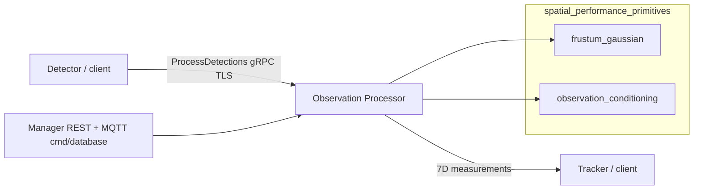

<!--
SPDX-FileCopyrightText: (C) 2026 Intel Corporation
SPDX-License-Identifier: Apache-2.0
-->

# Design Document: Observation Processor Service

- **Author(s)**: [Sarat Poluri](https://github.com/saratpoluri), [Jacek Chrapkowski](https://github.com/jacekchrapkowski)
- **Date**: 2026-11-12
- **Status**: `Proposed`
- **Related ADRs**:
  - [ADR 13 — Controller Breakdown into Functionality-Aligned Microservices](../adr/0013-controller-breakdown-microservices.md)
  - [ADR 7 — Tracker Service](../adr/0007-tracker-service.md)

---

## 1. Overview

The **Observation Processor** is the first deployable slice of ADR 13’s
**Spatial Transform & Projection Service**. It converts one camera frame of 2D
detections into world-space measurements suitable for the Tracker, using:

- **`frustum_gaussian`** — ray-elongated 3D Gaussian projection from image boxes
  and category size priors
- **`observation_conditioning`** (optional) — mesh-aware depth conditioning
  (floor/shelf contact, occlusion, walls) against a static scene GLB

Static scene, camera, and asset data are resolved out-of-band from the Manager
REST API. Clients call a unary TLS gRPC RPC (`ProcessDetections`). Compose
exposes the service under the `observation-processor` profile; Controller
cutover to this path is not required for the initial landing.

User-facing runbooks live in the
[Observation Processor user guide](../user-guide/microservices/observation-processor/observation-processor.md)
and [service README](../../observation_processor/README.md). Algorithm detail
for the libraries is in
[`spatial_performance_primitives/`](../../spatial_performance_primitives/).

## 2. Goals

- Provide a stable **v1 gRPC contract** for 2D→world measurements that map to
  robot-vision tracker inputs (`rv::tracking::TrackedObject` measurement layout).
- Support **frustum-only** and **mesh-conditioned** paths, with `AUTO` selecting
  mesh conditioning when a usable GLB is available.
- Keep static configuration out of the RPC: resolve scene mesh, camera
  calibration, and category priors from Manager; warm caches before readiness.
- Fail closed for bad frames (`INVALID_ARGUMENT` / `FAILED_PRECONDITION`) while
  allowing **soft-fail** for unusable meshes under `AUTO` so multi-scene
  deployments stay available.
- Ship as an optional Compose service with TLS and standard `grpc.health.v1`
  liveness/readiness.

## 3. Non-Goals

- Replacing in-process Controller / Tracker projection for all deployments in
  this change (no mandatory cutover).
- Multi-camera fusion, track association, or Kalman filtering (Tracker / ADR 7).
- Live camera pose (PTZ / Positioning); uses static Manager calibration today.
- Dynamic or deforming scene meshes; depth maps are baked per camera pose.
- Kubernetes / Helm deployment (Compose only for this landing).
- MQTT fan-out of measurements (sync gRPC only in v1).
- A pure-C++ critical path for the whole service (ADR 13’s long-term sketch);
  v1 is Python orchestration with a native frustum kernel and Python amodal
  reasoner.

## 4. Background / Context

Today, 2D→world projection and optional mesh heuristics live inside Controller /
Tracker paths. ADR 13 calls for a dedicated Spatial Transform & Projection
boundary so that:

- the Tracker consumes **world-space observations** with a clear contract
- projection can evolve (moving cameras, richer geometry) without bloating the
  Tracker
- latency and technology choices for projection can be measured independently

This service implements that boundary for **calibrated fixed cameras** and
**static GLB meshes**, using libraries vendored under
`spatial_performance_primitives/`.

## 5. Proposed Design

### 5.1 Runtime architecture

- **Ingress**: unary `ProcessDetections` on
  `scenescape.observation_processor.v1.ObservationProcessorService`.
- **Config**: Manager REST (`observation_processor.auth`) for scenes, cameras,
  assets; MQTT `scenescape/cmd/database` invalidates and refreshes the warm
  cache. Meshes prefer the shared media volume; HTTPS download from the Manager
  origin is fallback (no redirects; size-capped).
- **Egress**: ordered per-detection statuses and optional diagnostics; no MQTT
  publish in v1.

### 5.2 Libraries

| Package                    | Role                                                                   |
| -------------------------- | ---------------------------------------------------------------------- |
| `frustum_gaussian`         | Undistorted box → ray Gaussian (`project_frustum_batch` + world xform) |
| `observation_conditioning` | `AmodalReasoner`: condition depth using a baked mesh depth/normal map  |

Both packages are documented for agents and humans under
`spatial_performance_primitives/*/README.md` and `AGENTS.md`. Math notes:
`ALGORITHM.md` / `amodal_reasoner_algorithm.md`.

### 5.3 Conditioning modes

| Mode           | Behavior                                                               |
| -------------- | ---------------------------------------------------------------------- |
| `AUTO`         | `FULL` if a usable mesh is available; else `FRUSTUM_ONLY` (soft-fail)  |
| `FULL`         | Frustum + amodal; `FAILED_PRECONDITION` if no usable mesh              |
| `FRUSTUM_ONLY` | Skip amodal; per-detection `project_to_map` may still raycast the mesh |

Applied mode in the response is never `AUTO`.

### 5.4 Per-request pipeline

1. Validate request (IDs, timestamp, boxes, detection-count limit).
2. Pin a warmed configuration snapshot.
3. Resolve mode / mesh usability.
4. Build batch: undistort boxes, resolve category priors / `project_to_map`.
5. Frustum project and transform to world.
6. Optionally run amodal conditioning and/or mesh-foot placement.
7. Assemble 7D `Measurement` (mean + 7×7 `noise_covariance`) and statuses.

Depth sources when OK: `FRUSTUM`, `AMODAL`, or `MESH_FOOT`. Unobservable depth
returns `MEASUREMENT_STATUS_DEPTH_UNOBSERVABLE` without a measurement.

### 5.5 Cache, readiness, and soft-fail

- Eager warm of meshes and per-(scene, camera) reasoners before
  `grpc.health.v1` readiness `SERVING`.
- Invalidation on Manager database events; previous snapshot remains live until
  the replacement finishes loading. Failed store refreshes keep the last good
  snapshot.
- A mesh that fails for one scene is logged and skipped (prior mesh retained
  when present); other scenes still become ready; `AUTO` uses frustum-only for
  that scene.
- Hard limits: max detections per request; max camera pixels for amodal bake;
  max GLB size (100 MiB) before load.

### 5.6 Wire contract and errors

Canonical schema:
[`observation_processor.proto`](../../observation_processor/proto/observation_processor.proto).

Whole-frame gRPC statuses:

| Status                | Typical cause                                                  |
| --------------------- | -------------------------------------------------------------- |
| `INVALID_ARGUMENT`    | Missing/invalid fields; detection-count limit exceeded         |
| `NOT_FOUND`           | Unknown scene/camera                                           |
| `FAILED_PRECONDITION` | Bad calibration; resolution/mesh/asset limits; `FULL` w/o mesh |
| `UNAVAILABLE`         | No warmed snapshot / store unreachable                         |
| `INTERNAL`            | Projection or conditioning failure                             |

On error, clients should keep any legacy in-process projection for that frame
(same guidance as the proto header).

### 5.7 Security

- TLS by default (Compose mounts `scenescape-observation-processor` certs).
- `OBSERVATION_PROCESSOR_INSECURE=1` only for local development.
- Dedicated non-superuser Manager auth secret for REST/MQTT.

## 6. Alternatives Considered

| Option                                     | Why not for v1                                        |
| ------------------------------------------ | ----------------------------------------------------- |
| Keep projection only in Controller/Tracker | Blocks ADR 13 decomposition and independent scale     |
| MQTT-only measurement stream               | Tracker needs sync request/response for frame join    |
| Require mesh always (`FULL` only)          | Breaks scenes without GLB; poor multi-scene warm      |
| Pure C++ service as in ADR 13 sketch       | Higher cutover cost; Python+native kernel ships first |
| Embed libraries only in Tracker process    | No separate deploy/test boundary for projection       |

## 7. Risks and Mitigations

| Risk                                         | Mitigation                                                                                          |
| -------------------------------------------- | --------------------------------------------------------------------------------------------------- |
| gRPC hop latency vs in-process projection    | Measure before Controller cutover; co-locate on Compose network; optional later in-process fallback |
| Large / bad GLBs block readiness             | Soft-skip per scene; size cap; `AUTO`→frustum-only                                                  |
| Contract drift vs Tracker measurement layout | Proto documents RV index layout; unit/loopback tests                                                |
| Amodal bake cost on first request            | Warm reasoners before `SERVING`                                                                     |
| ADR 13 C++ critical-path expectation         | Document v1 tech choice; revisit if SLOs require a native rewrite                                   |

## 8. Rollout / Migration Plan

1. Land service + libraries + Compose profile + user guide (this change).
2. Validate with sample client / BAT-adjacent demos; no default Controller routing.
3. Optional caller integration behind a feature flag; compare residuals vs legacy
   projection.
4. Helm chart and Controller cutover in a later change.
5. Package version remains the wire compatibility boundary (`v1` additive only).

## 9. Testing & Monitoring

- Unit / loopback gRPC tests under
  `tests/sscape_tests/observation_processor/` (warmup, modes, TLS, projection).
- Library tests under `spatial_performance_primitives/*/tests/` (and frustum C++
  GoogleTest via service Makefile targets).
- Container health: `python3 -m observation_processor.healthcheck` against
  `grpc.health.v1`.
- Cognitive complexity and coverage gates apply to
  `observation_processor` / `spatial_performance_primitives` like other Python
  services.
- Operational metrics beyond health are follow-up (OpenTelemetry parity with
  Tracker is not in v1).

## 10. Open Questions

- When and how Controller/Tracker switch from legacy projection to this RPC by
  default.
- Whether a later native rewrite of amodal conditioning is required for ADR 13
  latency goals.
- Helm / Kubernetes packaging shape.
- MQTT fan-out of diagnostics or measurements for offline analytics.

## 11. References

- [ADR 13 — Controller Breakdown](../adr/0013-controller-breakdown-microservices.md)
- [ADR 7 — Tracker Service](../adr/0007-tracker-service.md)
- [User guide — Observation Processor](../user-guide/microservices/observation-processor/observation-processor.md)
- [Proto](../../observation_processor/proto/observation_processor.proto)
- [frustum_gaussian README](../../spatial_performance_primitives/frustum_gaussian/README.md)
- [observation_conditioning README](../../spatial_performance_primitives/observation_conditioning/README.md)
