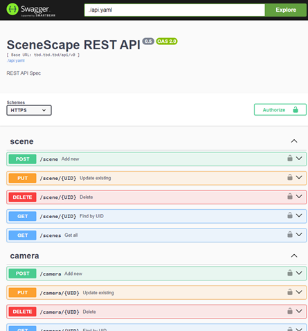

# API Reference

## Camera Pose Lock

Camera create/update requests and camera responses, including cameras nested in
scene responses, expose `pose_locked`. Manager stores posed perceptual sensors as
`Cam` entities; the same lock and ephemeral MQTT pose/optics rules apply to RGB,
depth, LiDAR/radar detectors, and similar modalities registered as cameras and
publishing on `scenescape/data/camera/{id}`. External-source publishers (ADR 16)
use a separate ephemeral TTL pose/intrinsics cache and do not use `pose_locked`.

- `false` (default for new cameras): stored calibration initializes the runtime
  pose. Valid observation extrinsics replace it in cache only; missing or invalid
  extrinsics retain the last valid pose. Configuration refreshes preserve
  observed transforms and MQTT optics while unlocked.
- `true` (default for calibrated cameras in the UI, and for existing cameras
  after migration): only stored calibration controls the runtime pose and
  optics. Incoming camera-message extrinsics and optics (`intrinsics`,
  `distortion`, `resolution`) cannot override it.

Use the **Pose locked** checkbox on the camera creation or calibration form, or
send a lock-only update such as `{"pose_locked": true}` to `/api/v1/camera/{id}`.
Omitted fields on updates preserve the current value; non-boolean values are
rejected. The additive migration backfills existing database cameras as locked;
new creates default unlocked. Scene archives preserve the field when present.

Controller and Analytics use the same rules. Switching to locked reloads stored
calibration when each consumer refreshes configuration. Unlocking starts from
that calibration until another valid observation. Saving calibration alone does
not reset an already observed pose. Observations never overwrite durable
calibration. Live poses have no expiry and are discarded on camera removal,
scene reassignment, or process restart. Retention is local to each running scene
instance; lock changes are not an instantaneous distributed cutover for queued
messages.

Cam create/update and nested scene camera payloads also expose
`calibration_origin` (durable writer identity; default `manager.rest`) and a
read-only `pose_provenance` object derived from it for Manager config.
Regulated MQTT camera entries publish runtime `pose_provenance` (`class` +
`origin`) for the effective **pose** only. Intrinsics / distortion / resolution
have no provenance field; optics-only MQTT updates do not stamp
`pose_provenance`. The 3D UI follows poses when `pose_provenance.class` is
`live` (and the camera is unlocked). The deprecated `dynamic_pose` flag remains
as an alias of `class === "live"` during migration. See
[ADR 18](../adr/0018-camera-pose-provenance.md) and
[Analytics data formats](microservices/analytics/data_formats.md).

Upgrade Manager, the shared library, Controller, and Analytics together before
relying on lock enforcement. Apply the additive camera lock migration to
existing databases; it backfills existing cameras as locked and does not migrate
calibration values. Older workers ignore the lock. Apply the
`calibration_origin` migration so Manager can stamp durable provenance origins
(`manager.rest`, `manager.mesh`, `manager.import`).

## Source Map Errors

Source-map activation requires the explicit
`POST /api/v1/scene/{scene_id}/maps/{method}/activate` path; `POST` on the map
resource itself returns HTTP 405. Activation and deletion
(`DELETE /api/v1/scene/{scene_id}/maps/{method}`) return safe,
actionable messages in the JSON `error` field for rejected operations, while
preserving the HTTP status code. For example, deleting the default map returns
HTTP 409 with `{"error": "Cannot delete the default map"}`. Concurrent mapping
changes also return HTTP 409, with a distinct retry message. Unclassified errors
return a generic message without internal implementation details.

## API Specification Viewing Instructions

`docs/user-guide/api-docs/api.yaml` covers the token-authenticated REST API under `/api/v1`. It does not cover browser-session endpoints used by the Manager UI.

Follow the steps below, or see the [Swagger UI Installation Guide](https://github.com/swagger-api/swagger-ui/blob/main/docs/usage/installation.md) for full instructions.

### 1. Pull Swagger UI image

```
docker pull swaggerapi/swagger-ui
```

### 2. Run the Swagger UI container

Use a configuration that loads the Scenescape `docs/user-guide/api-docs/api.yaml` definitions.

General Syntax:

```
docker run -p 80:8080 --user $(id -u):$(id -g) -e SWAGGER_JSON=/mnt/api.yaml -v <full path to parent directory of api.yaml>:/mnt swaggerapi/swagger-ui
```

See the [Swagger UI Configuration Guide](https://github.com/swagger-api/swagger-ui/blob/main/docs/usage/configuration.md).

Example:

```
docker run -p 80:8080 --user $(id -u):$(id -g) -e SWAGGER_JSON=/mnt/api.yaml -v ~/scenescape/docs/user-guide/api-docs:/mnt swaggerapi/swagger-ui
```

> **Note:** Ensure that for the -v option you use the correct path to where Scenescape repository was cloned (`~/scenescape/` in the example above).

### 3. View API docs via a browser

Navigate to `http://localhost`

> **Note:** `https:` is not supported. `localhost` can be replaced with the ip address.

It should look something like this example:



## Open API

**Version: 1.3.0**:

```{eval-rst}
.. swagger-plugin:: ./api-docs/api.yaml
```
