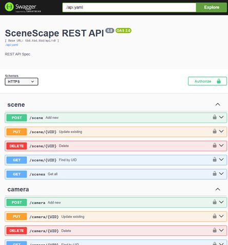

# API Reference

## Camera Pose Policy

Camera create/update requests and camera responses, including cameras nested in
scene responses, expose `pose_policy`:

- `observation` (default): configured calibration initializes the runtime pose.
  Valid observation extrinsics replace it; missing or invalid extrinsics retain
  the last valid pose. Configuration refreshes preserve observed transforms
  while updating optics.
- `configured`: only stored calibration controls the runtime pose. Observation
  extrinsics cannot override it.

Choose **Pose policy** on the camera creation or calibration/settings form, or
send a policy-only update such as `{"pose_policy": "configured"}` to
`/api/v1/camera/{id}`. Omitted fields on updates preserve the current policy;
explicit null, blank, or unknown values are rejected. Existing cameras and
older registrations without this field default to `observation`. Scene archives
preserve the field; older archives use the same default.

Controller and Analytics use the same rules. Switching to `configured` reloads
stored calibration when each consumer refreshes configuration. Switching back
to `observation` starts from that calibration until another valid observation.
Saving calibration alone does not reset an already observed pose. Observations
never overwrite durable calibration. Live poses have no expiry and are discarded
on camera removal, scene reassignment, or process restart. Retention is local to
each running scene instance; policy changes are not an instantaneous distributed
cutover for queued messages.

Upgrade Manager, the shared library, Controller, and Analytics together before
relying on configured-only enforcement. Apply the additive camera-policy migration
to existing databases; no calibration values are migrated. Older workers ignore
the policy, and rolling back to them restores their prior observation behavior.

## Source Map Errors

Source-map activation (`POST /api/v1/scene/{scene_id}/maps/{method}/activate`)
and deletion (`DELETE /api/v1/scene/{scene_id}/maps/{method}`) return safe,
actionable messages in the JSON `error` field for rejected operations, while
preserving the HTTP status code. For example, deleting the default map returns
HTTP 409 with `{"error": "Cannot delete the default map"}`. Concurrent mapping
changes also return HTTP 409, with a distinct retry message. Unclassified errors
return a generic message without internal implementation details.

## API Specification Viewing Instructions

Follow the steps below, or see the [Swagger UI Installation Guide](https://github.com/swagger-api/swagger-ui/blob/main/docs/usage/installation.md) for full instructions.

### 1. Pull Swagger UI image

```
docker pull swaggerapi/swagger-ui
```

### 2. Run the Swagger UI container

Use a configuration that loads the Scenescape `docs/user-guide/api-docs/api.yaml` definitions.

General Syntax:

```
docker run -p 80:8080 --user $(id -u):$(id -g) -e SWAGGER_JSON=/mnt/api.yaml -v <full path to parent directory of api.yaml>:/mnt swaggerapi/swagger-ui
```

See the [Swagger UI Configuration Guide](https://github.com/swagger-api/swagger-ui/blob/main/docs/usage/configuration.md).

Example:

```
docker run -p 80:8080 --user $(id -u):$(id -g) -e SWAGGER_JSON=/mnt/api.yaml -v ~/scenescape/docs/user-guide/api-docs:/mnt swaggerapi/swagger-ui
```

> **Note:** Ensure that for the -v option you use the correct path to where Scenescape repository was cloned (`~/scenescape/` in the example above).

### 3. View API docs via a browser

Navigate to `http://localhost`

> **Note:** `https:` is not supported. `localhost` can be replaced with the ip address.

It should look something like this example:



## Open API

**Version: 1.3.0**:

```{eval-rst}
.. swagger-plugin:: ./api-docs/api.yaml
```
