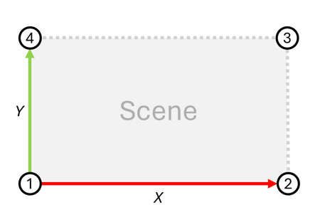

# Configure Geospatial Coordinates for a Scene

With this guide, you will learn how to configure Scenescape to output geospatial coordinates of detected objects. It involves:

- Setting up reference points of the scene, using local and geospatial coordinate systems.
- Configuring Scenescape to properly calculate and publish geospatial coordinates (latitude, longitude, altitude).
- Verifying if the coordinates of detected objects are published in MQTT messages.

## Assumptions

To ensure reliability of converting the local coordinates to geospatial ones (accuracy within ~1 meter), certain conditions need to be met. Deviating from these base assumptions may result in inaccurate values of latitude, longitude, and altitude. You can still use the feature without meeting the conditions, in which case, the accuracy of the conversions must be validated experimentally.

- The scene surface is horizontal and relatively flat.
- Both scene surface dimensions (X and Y) are less than 400 meters in length.
- Detected objects are located less than two meters above the scene surface.
- Map corners' geographic coordinates are measured with a negligible measurement error.

## Prerequisites

- **Dependencies Installed**: Scenescape deployed, MQTT client installed, and MQTT access credentials configured.
- **Access and Permissions**: Appropriate access to edit the scene with the UI and receive MQTT messages on the scene regulated topic.

## Steps to Leverage Built-In Geospatial Map Creation

1. Before launching an Scenescape instance, ensure the API keys are configured for the selected map provider ([Configure geospatial map service API keys](./configure-geospatial-map-service-api-keys.md)). If the instance is already running, stop the current Web UI container and start a new instance.
1. Click the "New Scene" button at the top right corner of the web homepage.```
1. Switch the "Map Type" to "Geospatial Map".
1. Select the provider for which you have configured the API key.
1. Type the address of interest in the "Location" field and click "Go".
1. Use the controls on the map frame to zoom in or out as needed. The map is always north-up; rotation is disabled for every provider so that the generated map corners match the scene axes.
1. Click "Generate Geospatial Bounds & Snapshot" so that:
   - "Output Geospatial Coordinates" field is set to "Yes".
   - "Map Corners" are autopopulated with the geospatial coordinates of the four corners of the map.
   - "Pixels per meter" field is autopopulated with the scale of the scene.
   - A scene previously saved with a rotated Mapbox map is reset to north-up.
1. Click "Save Scene".
1. For additional details on configuring a scene, follow the [new scene guide](./create-new-scene.md)

## Alternative: Steps to Manually Configure Geospatial Coordinates of the Scene

1. Launch the Scenescape UI and **Log In**.
1. Create a scene as outlined in the [new scene guide](./create-new-scene.md):

- A scene surface map should be rectangular with edges aligned to the X and Y axes (explicit alignment is required for scenes using 3D models, flat maps loaded from images use it by design). See the next sections for how to verify this condition in practice.
- Scene scale (pixels per meter) is set up properly.
- The geospatial coordinates of the four map corners have been measured at the scene surface level. Refer to the [Conventions](#conventions) section for how to determine the scene corners.

1. If the scene map is loaded as a 3D model, set up axes, otherwise, skip to step 2.
   - Click the **3D** button.
   - Make sure the scene is properly positioned relative to X and Y axis. The X axis is red. The Y axis is green.
   - Go back to the scene setup page.
1. Click the **Edit** button (pencil icon).
1. Set `Output geospatial coordinates` to `Yes`.
1. Input the geospatial coordinates of the four map corners in the JSON format. See the [Conventions](#conventions) section for details on how to specify the input value.
1. Click the **Save Scene Updates** button. Check for any errors reported and fix them if they appear. A scene with `Output geospatial coordinates` set to `Yes` must keep a map: ticking **Clear** on the map is rejected, so upload a replacement map instead.

### Conventions

- **Determining the Reference Points**: The reference points needed for the conversion are four map corners, which are determined relative to the map using the following convention:
  - For scene maps loaded as an image, Scenescape internally determines the map corners as the corners of the image.
  - For scene maps loaded as a 3D model, Scenescape internally determines the map corners by projecting the scene to the XY plane and calculating an axis-aligned bounding box of the scene projection.

- **Specifying the Geospatial Coordinates of the Reference Points**: The geospatial coordinates of the reference points, which are the four map corners, should be specified using the following convention:
  - Input format should be a JSON array, for example:

    ```json
    [
      [33.842058, -112.136117, 539],
      [33.842175, -112.134245, 539],
      [33.843923, -112.134407, 539],
      [33.843811, -112.136257, 539]
    ]
    ```

  - The expected order of the four map corners is counterclockwise starting in the lower left as depicted in the figure below:

    

  - Corners listed clockwise from the same starting corner (lower left, upper left, upper right, lower right) are accepted as well. This is the order written by the built-in geospatial map generation. Scenescape detects the direction automatically, but the first corner must always be the one at the scene origin (lower left).

## Verify Successful Geospatial Coordinate Configuration

1. Open the MQTT client and connect to the Scenescape server on port 1883 with valid credentials.
1. Open the scene topic at `scenescape/regulated/scene` in the MQTT client and monitor the notifications about detected objects.

**Expected Result**: the `.object[].lat_long_alt` field in the messages contains correct geospatial coordinates of detected objects.

## Using a 3D Model as Scene Map

For scenes that use a 3D model (GLB file) as the map:

### 3D Model Prerequisites

- The scene's **Map Type** is **Geospatial Map**. The 3D model section and the REST endpoints reject other map types.
- The scene has a saved map centre (latitude and longitude). Until the scene is saved with a map centre, the file picker is disabled and the preview request returns `400`. Select a location on the map as described in [Steps to Leverage Built-In Geospatial Map Creation](#steps-to-leverage-built-in-geospatial-map-creation) and click **Save Scene**.
- The `.glb` file is no larger than the upload limit. The limit is 132 MB by default and is set by the `GLB_UPLOAD_MAX_SIZE_MB` environment variable of the Manager service (value in MB). A larger file is rejected with `413`. The stock `docker-compose.yml` does not forward this variable, so add it to the Manager service's `environment` to change it. The number of 3D models a scene can hold is set by `GLB_MAX_LAYERS` (see [Multiple 3D Models](#multiple-3d-models)).
- The scene map is a flat image, not a `.glb`. A model can only be shown on the scene map over a flat base map image. If the scene map is a `.glb`, or a model is applied but no base map image is stored, applying or saving the model is rejected with `400`. Replace the scene map with an image first.
- Saving, applying, moving, or removing a model requires a superuser account.

### Anchor and Heading

The position of the model on the map is stored as an anchor:

- **Anchor** (`lat`, `lng`): the latitude and longitude of the centre of the model's footprint (its bounding rectangle on the ground plane). A new model starts at the scene's saved map centre. The anchor must be within 50 km of the map centre; the UI warns about a farther position and the API rejects it with `400`.
- **Heading** (`heading_deg`): the clockwise rotation of the model's +Y axis from true north, in degrees. `0` points north and `90` points east. The UI limits the heading to 0-359.9; the API normalises any value to the range 0 to below 360.

The saved anchor of each model is also reported by `GET /api/v1/scene/<scene_uid>/geospatial-glbs` (see [Multiple 3D Models](#multiple-3d-models)).

### Axis Convention

Scenescape expects an uploaded `.glb` to be Y-up, the glTF standard, and rotates it by `90.0` degrees about X (the scene's **X Rotation**) to bring it into the Z-up scene frame. This is the same convention as for every other uploaded `.glb` map, and a map downloaded from a scene can be uploaded to another scene as is. In the scene frame the X and Y axes span the ground plane and +Z points up. The footprint is the bounding rectangle of the rotated model in the XY plane, and the model is placed so that its lowest point sits at ground level (`z = 0`). The heading is measured from the +Y axis of the model in that Z-up frame (see [Anchor and Heading](#anchor-and-heading)).

Export the model as Y-up. A model that is already Z-up would be rotated onto its side.

### Hybrid View

When a model is shown on the scene map, Scenescape keeps the scene's flat map image as a base layer and places the model over it:

- The 3D scene view draws the base map image as a flat plane at ground level, with the model on top. The **Floor Plane** switch hides or shows the flat plane; the model stays visible.
- The 3D view frames the base map and the model together.
- The scene thumbnail shows the model's top-down view composited over the base map image.
- A scene whose map is a `.glb` with no base map image (a model uploaded directly as the scene map) is a legacy GLB-only scene. It shows only the model, with no flat plane, and the 3D view frames the model alone. Replace its map with an image to use the hybrid view.

### Staging and Saving a Model

1. Click the **Edit** button on the scene.
1. Scroll to the **3D model (GLB)** section.
1. Click **Choose File** and select a `.glb` file to upload. The name of the staged file appears beside the button, or **No file selected** when none is chosen. If a model is already staged or saved, you are first asked to confirm replacing it; declining keeps the current model, and a saved model stays in place until you save the new one.
1. Once the preview appears, set the 3D model's rotation (degrees clockwise from north) by dragging the knob of the rotation dial at the center of the preview. The dial appears when you hover over the preview (or tap it, or focus the knob with the keyboard) and while you rotate; it is hidden while you press or drag the preview, and it never grows beyond 75% of the preview's size when you zoom out. Dragging snaps lightly to 0, 90, 180 and 270 degrees (within 5 degrees); hold **Shift** while dragging to turn snapping off and rotate at a quarter of the speed for fine adjustment. With the knob focused, the arrow keys change the heading by 1 degree (15 with **Shift**). The preview is semi-transparent, so the map beneath stays visible while you match colors and boundaries. The map view does not move when the model is uploaded; pan or zoom the map to find the preview if it sits outside the current view.
1. Drag the model's preview on the map to reposition it as needed.
1. Press and hold the model, or drag it, to make it transparent so the map underneath shows through; it returns to its normal opacity when you release.
1. Click **Save Scene Updates** to store the 3D model and its position with the scene, in the same save as the other scene fields; if that save fails validation, the model is not stored. If the scene has a flat base map image, the model is also applied to the scene map at once; a scene without one keeps the model stored but not applied. You can unapply and reapply the model with the **Show saved 3D model on scene map** checkbox (see below). **Cancel**, next to the file picker, discards the staged model.

### Managing Saved 3D Models

Once a 3D model is saved to a scene:

- The **Saved 3D model** block displays the model filename with **Download** and **Remove** options.
- The model's top-down preview is drawn on the map as an overlay whenever the scene page loads, whether or not the model is applied to the scene. The same preview image is used in both states; only the outline colour changes. It is drawn semi-transparent, a little less so than the preview shown while staging, so the map underneath stays visible, and it becomes more transparent while you press, drag or rotate it. The overlay is drawn at the scene's saved map view, so pan the map to find it if the model sits outside that view. If the preview cannot be generated, a message appears in the 3D model section instead of the overlay.
- The **Show saved 3D model on scene map** checkbox controls whether the model is shown on the scene map over the base map image (checked) or shown as a reference overlay only (unchecked). See [Hybrid View](#hybrid-view). A newly saved model starts checked when the scene has a flat base map image. Unchecking the checkbox unapplies the model, and checking it again applies it from the saved state. Changing the checkbox takes effect immediately. The checkbox does not change the model's position. The model's overlay on the map has a green dashed outline while the model is applied and a red dashed outline when it is not applied. While you stage a replacement model, the **Saved 3D model** block and the outline are hidden until you save or cancel.
- To move or rotate a saved model, drag its overlay on the map and rotate it with the rotation dial on the overlay. To discard unsaved changes to a saved model, reload the page.
- After the overlay is moved or rotated, a **Save position** button appears next to **Download** and **Remove**. Click it to persist the new position and heading. The button hides again once the saved position matches the overlay. Saving a position while the model is applied also moves the scene map to the new position.
- **Save Scene Updates** also persists a moved or rotated model. Use it when you are changing other scene settings at the same time: the new position is saved in the same request as those settings. If the save fails validation, nothing is saved, including the moved position. Fix the error, then move the model again.
- Click **Remove** to delete the saved 3D model (a confirmation dialog appears first). This cannot be undone.
- If the scene's map, pose, or 3D model was changed (for example from another browser tab) after the page was loaded, **Save Scene Updates** is rejected and the page reloads with the current values. Re-enter your edits and save again.

The following table describes what each action changes. Cameras, regions, sensors, and the scene's local coordinates are never changed by these actions. A placed model uses the local coordinate frame of the map it sits on, with its origin at the south-west corner of that map, so regions, cameras, and sensors stay at the same place on the map, and objects keep the same latitude and longitude, when a model is applied, unapplied, moved, or replaced. The 2D scene views offset the model's image by its position in that frame, so a region drawn on an applied model is stored in the same frame as one drawn on the map.

| Action                                             | Stored model and position                                                                                                             | Scene map                                                                                                                                                                                                                                                                                  |
| -------------------------------------------------- | ------------------------------------------------------------------------------------------------------------------------------------- | ------------------------------------------------------------------------------------------------------------------------------------------------------------------------------------------------------------------------------------------------------------------------------------------ |
| **Save Scene Updates** (first save or replacement) | Stores the new model file and position. A replaced model and its preview are deleted only after the new model is stored successfully. | If the scene has a flat base map image and the model was not applied, the new model is applied at the saved position. If the model was already applied, the new model replaces it at the saved position. Otherwise the scene map is unchanged.                                             |
| Checkbox checked (apply)                           | Sets the applied state. The model is kept.                                                                                            | Saves a snapshot of the current scene map in its own file type as the base map, then shows the model over it at the saved position.                                                                                                                                                        |
| Checkbox unchecked (unapply)                       | Clears the applied state. The model is kept.                                                                                          | Restores the snapshot taken when the model was applied, in its original file type. After a replacement, this is still the original map, not the replaced model. If the scene had no map when the model was applied, the scene map is left empty and must be replaced before the next save. |
| **Save position**                                  | Updates the saved position.                                                                                                           | If the model is applied, the scene map moves to the new position immediately. If not, only the saved position changes.                                                                                                                                                                     |
| **Save Scene Updates** (moved model)               | Updates the saved position in the same save as the other scene fields.                                                                | If the model is applied, the scene map moves to the new position in the same save. If the save fails, neither the position nor the other fields change.                                                                                                                                    |
| **Remove**                                         | Deletes the model file, its preview, and its position.                                                                                | If the model is applied, the original map is restored first.                                                                                                                                                                                                                               |

### Uploading a Replacement 3D Model

To replace a saved 3D model:

1. Upload a new file using the file picker; the new model appears as a preview on the map, with a **Cancel** button next to the picker.
1. Adjust the heading and position as needed (the preview starts at the saved model's position).
1. Click **Save Scene Updates** to replace the saved model. If the scene has a flat base map image, the new model is applied at the new position, as with a first save. Otherwise the scene map is unchanged and the new model stays unapplied. If the save fails, the saved model is kept unchanged.
1. Click **Cancel** to discard the staged file and return to the saved model.

### Multiple 3D Models

A scene can hold up to `GLB_MAX_LAYERS` 3D models, called layers. The default is `100`. Set `GLB_MAX_LAYERS` in the Manager service's environment to a different number to change the limit, or to `1` for the single-model behaviour described above. With Docker Compose the stock `docker-compose.yml` forwards `GLB_MAX_LAYERS` from the shell or `.env` file (default `100`). With the Helm chart, set `web.glbMaxLayers` (default `100`). The add-layer control in the 3D model section appears only when the limit is above `1`.

- Each layer has its own file, anchor and heading, and applied state.
- Layers are numbered 1, 2, and so on in draw order, and the order cannot be changed. When the scene has two or more layers, each layer's panel shows its number as a badge at the top-left corner of the panel. The number is also shown in a badge at the NW corner of the layer's footprint on the scene map. A single layer is not numbered. Numbers follow the saved draw order, so removing a layer renumbers the layers after it.
- A saved layer's panel shows the first 8 characters of its ID after the file name. Hover over the ID to see the full ID.
- The frame of each layer on the scene map is 5 px wide. Its colour shows whether the layer is applied (green) or not (red).
- A new layer is placed on the scene map only when it is enabled and the scene has a flat base map image. Otherwise it is stored disabled. The enabled layers are combined into the scene map.
- Replacing the file of an existing layer does not count toward the limit. Adding a layer to a scene that already holds `GLB_MAX_LAYERS` layers is rejected with `409`.
- Removing a layer deletes its file and preview. If it was enabled, the scene map is rebuilt without it.
- The 50 km anchor limit, the file size limit, and the superuser requirement apply to each layer.

The layer endpoints are:

- `GET /api/v1/scene/<scene_uid>/geospatial-glbs`: list the layers and `max_layers`.
- `POST /api/v1/scene/<scene_uid>/geospatial-glbs`: store a staged file as a new layer, or as the new file of `layer_id`.
- `PUT /api/v1/scene/<scene_uid>/geospatial-glbs/<layer_id>`: move a layer or place it on the map (`enabled`).
- `DELETE /api/v1/scene/<scene_uid>/geospatial-glbs/<layer_id>`: remove a layer.
- `GET /api/v1/scene/<scene_uid>/geospatial-glbs/<layer_id>/download`: download the layer's file.

The single-model routes under `/geospatial-glb` were replaced by these routes. Clients that used them must switch to the layer routes.

### Effect on Running Services

Every save that changes the scene, including applying, unapplying, moving, replacing, or removing a 3D model, makes the Manager publish a database update notice over MQTT when the change is committed. The Scene Controller and Analytics services react to it by reloading the scenes from the Manager, so no restart is needed. When the scene data changed, the Scene Controller builds a new scene with a new tracker, so tracking in that scene starts over and object IDs can change.

## REST API Reference

Geospatial output can also be configured without the UI by creating the scene first (see
[Create and Configure a New Scene](./create-new-scene.md#rest-api-reference)) and then updating it
with `PUT /api/v1/scene/<scene_uid>` (the manager applies this as a partial update, so omitted
fields are left unchanged; the endpoint does not support `PATCH`):

```bash
curl -sk -X PUT https://<manager-host>/api/v1/scene/<scene_uid> \
    -H "Authorization: Token $TOKEN" \
    -H "Content-Type: application/json" \
    -d '{
        "output_lla": true,
        "map_corners_lla": [
            [<lat1>, <lon1>, <alt1>],
            [<lat2>, <lon2>, <alt2>],
            [<lat3>, <lon3>, <alt3>],
            [<lat4>, <lon4>, <alt4>]
        ]
    }'
```

- `map_corners_lla` is required whenever `output_lla` is `true` — the request is rejected
  otherwise.
- The four corners follow the same counterclockwise-from-lower-left convention described in
  [Conventions](#conventions) above (clockwise from the lower left is accepted as well).
- Full field reference: [API Reference](../../api-reference.md) (`Scene` schema).
