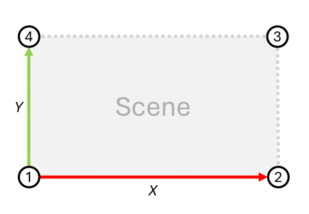

# Configure Geospatial Coordinates for a Scene

With this guide, you will learn how to configure Scenescape to output geospatial coordinates of detected objects. It involves:

- Setting up reference points of the scene, using local and geospatial coordinate systems.
- Configuring Scenescape to properly calculate and publish geospatial coordinates (latitude, longitude, altitude).
- Verifying if the coordinates of detected objects are published in MQTT messages.

## Assumptions

To ensure reliability of converting the local coordinates to geospatial ones (accuracy within ~1 meter), certain conditions need to be met. Deviating from these base assumptions may result in inaccurate values of latitude, longitude, and altitude. You can still use the feature without meeting the conditions, in which case, the accuracy of the conversions must be validated experimentally.

- The scene surface is horizontal and relatively flat.
- Both scene surface dimensions (X and Y) are less than 400 meters in length.
- Detected objects are located less than two meters above the scene surface.
- Map corners' geographic coordinates are measured with a negligible measurement error.

## Prerequisites

- **Dependencies Installed**: Scenescape deployed, MQTT client installed, and MQTT access credentials configured.
- **Access and Permissions**: Appropriate access to edit the scene with the UI and receive MQTT messages on the scene regulated topic.

## Steps to Leverage Built-In Geospatial Map Creation

1. Before launching an Scenescape instance, ensure the API keys are configured for the selected map provider ([Configure geospatial map service API keys](./configure-geospatial-map-service-api-keys.md)). If the instance is already running, stop the current Web UI container and start a new instance.
1. Click the "New Scene" button at the top right corner of the web homepage.```
1. Switch the "Map Type" to "Geospatial Map".
1. Select the provider for which you have configured the API key.
1. Type the address of interest in the "Location" field and click "Go".
1. Use the controls on the map frame to zoom in or out as needed. The map is always north-up; rotation is disabled for every provider so that the generated map corners match the scene axes.
1. Click "Generate Geospatial Bounds & Snapshot" so that:
   - "Output Geospatial Coordinates" field is set to "Yes".
   - "Map Corners" are autopopulated with the geospatial coordinates of the four corners of the map.
   - "Pixels per meter" field is autopopulated with the scale of the scene.
   - A scene previously saved with a rotated Mapbox map is reset to north-up.
1. Click "Save Scene".
1. For additional details on configuring a scene, follow the [new scene guide](./create-new-scene.md)

## Alternative: Steps to Manually Configure Geospatial Coordinates of the Scene

1. Launch the Scenescape UI and **Log In**.
1. Create a scene as outlined in the [new scene guide](./create-new-scene.md):

- A scene surface map should be rectangular with edges aligned to the X and Y axes (explicit alignment is required for scenes using 3D models, flat maps loaded from images use it by design). See the next sections for how to verify this condition in practice.
- Scene scale (pixels per meter) is set up properly.
- The geospatial coordinates of the four map corners have been measured at the scene surface level. Refer to the [Conventions](#conventions) section for how to determine the scene corners.

1. If the scene map is loaded as a 3D model, set up axes, otherwise, skip to step 2.
   - Click the **3D** button.
   - Make sure the scene is properly positioned relative to X and Y axis. The X axis is red. The Y axis is green.
   - Go back to the scene setup page.
1. Click the **Edit** button (pencil icon).
1. Set `Output geospatial coordinates` to `Yes`.
1. Input the geospatial coordinates of the four map corners in the JSON format. See the [Conventions](#conventions) section for details on how to specify the input value.
1. Click the **Save Scene Updates** button. Check for any errors reported and fix them if they appear. A scene with `Output geospatial coordinates` set to `Yes` must keep a map: ticking **Clear** on the map is rejected, so upload a replacement map instead.

### Conventions

- **Determining the Reference Points**: The reference points needed for the conversion are four map corners, which are determined relative to the map using the following convention:
  - For scene maps loaded as an image, Scenescape internally determines the map corners as the corners of the image.
  - For scene maps loaded as a 3D model, Scenescape internally determines the map corners by projecting the scene to the XY plane and calculating an axis-aligned bounding box of the scene projection.

- **Specifying the Geospatial Coordinates of the Reference Points**: The geospatial coordinates of the reference points, which are the four map corners, should be specified using the following convention:
  - Input format should be a JSON array, for example:

    ```json
    [
      [33.842058, -112.136117, 539],
      [33.842175, -112.134245, 539],
      [33.843923, -112.134407, 539],
      [33.843811, -112.136257, 539]
    ]
    ```

  - The expected order of the four map corners is counterclockwise starting in the lower left as depicted in the figure below:

    

  - Corners listed clockwise from the same starting corner (lower left, upper left, upper right, lower right) are accepted as well. This is the order written by the built-in geospatial map generation. Scenescape detects the direction automatically, but the first corner must always be the one at the scene origin (lower left).

## Verify Successful Geospatial Coordinate Configuration

1. Open the MQTT client and connect to the Scenescape server on port 1883 with valid credentials.
1. Open the scene topic at `scenescape/regulated/scene` in the MQTT client and monitor the notifications about detected objects.

**Expected Result**: the `.object[].lat_long_alt` field in the messages contains correct geospatial coordinates of detected objects.

## Using a 3D Model as Scene Map

For scenes that use a 3D model (GLB file) as the map:

1. Click the **Edit** button on the scene.
1. Scroll to the **3D model (GLB)** section.
1. Click **Browse** and select a `.glb` file to upload. If a model is already staged or saved, you are first asked to confirm replacing it; declining keeps the current model, and a saved model stays in place until you accept the new one.
1. Once the preview appears, use the **Heading** slider and text input to adjust the 3D model's rotation (degrees clockwise from north). The map view does not move when the model is uploaded; pan or zoom the map to find the preview if it sits outside the current view.
1. Drag the model's preview on the map to reposition it as needed.
1. Adjust **Opacity** to see the underlying map through the model.
1. Click **Accept** to store the 3D model and its position with the scene. Accept alone does not make the model the scene map; use the **Apply saved 3D model to scene map** checkbox for that (see below). The page then reloads at the map view you had when you accepted, as long as the map provider is unchanged. Clicking **Save Scene Updates** with a staged model also stores it, in the same save as the other scene fields; if that save fails validation, the model is not stored.

### Managing Saved 3D Models

Once a 3D model is saved to a scene:

- The **Saved 3D model** block displays the model filename with **Download** and **Remove** options.
- The model's top-down preview is drawn on the map as an overlay whenever the scene page loads, whether or not the model is applied to the scene. The same preview image is used in both states; only the outline colour changes. It is drawn at full opacity so it stands apart from the semi-transparent preview shown while staging. The **Opacity** slider only applies while staging, and the overlay is drawn at the scene's saved map view, so pan the map to find it if the model sits outside that view. If the preview cannot be generated, a message appears in the 3D model section instead of the overlay.
- The **Apply saved 3D model to scene map** checkbox controls whether the model is used as the scene's map (checked) or shown as a reference overlay only (unchecked). Changing the checkbox takes effect immediately. The checkbox does not change the model's position. The model's overlay on the map has a green dashed outline while the model is applied and a red dashed outline when it is not applied. While you stage a replacement model, the **Saved 3D model** block and the outline are hidden until you accept or cancel.
- To move a saved model, drag its overlay on the map. The **Heading** slider is not shown for a saved model, so changing its rotation requires uploading a replacement file (see below).
- After the overlay is moved, a **Save position** button appears next to **Download** and **Remove**. Click it to persist the new position. The button hides again once the saved position matches the overlay. Saving a position while the model is applied also moves the scene map to the new position.
- **Save Scene Updates** also persists a moved position. Use it when you are changing other scene settings at the same time: the moved position is saved in the same request as those settings. If the save fails validation, nothing is saved, including the moved position. Fix the error, then move the model again.
- Click **Remove** to delete the saved 3D model (a confirmation dialog appears first). This cannot be undone.
- If the scene's map, pose, or 3D model was changed (for example from another browser tab) after the page was loaded, **Save Scene Updates** is rejected and the page reloads with the current values. Re-enter your edits and save again.

The following table describes what each action changes. Cameras, regions, sensors, and the scene's local coordinates are never changed by these actions. The geospatial reference is different: while a model is applied, the map corners and footprint come from the model. This means the latitude and longitude reported for objects change when a model is applied or unapplied, and when an applied model is moved or replaced.

| Action                                 | Stored model and position                                                                                                             | Scene map                                                                                                                                                                                                                                                                                  |
| -------------------------------------- | ------------------------------------------------------------------------------------------------------------------------------------- | ------------------------------------------------------------------------------------------------------------------------------------------------------------------------------------------------------------------------------------------------------------------------------------------ |
| **Accept** or **Save Scene Updates** (first save or replacement) | Stores the new model file and position. A replaced model and its preview are deleted only after the new model is stored successfully. | If the saved model is not applied, the scene map is unchanged. If it is applied, the scene map switches to the new model at the new position immediately.                                                                                                                                  |
| Checkbox checked (apply)               | Sets the applied state. The model is kept.                                                                                            | Saves a snapshot of the current scene map in its own file type, then uses the model as the map at the saved position.                                                                                                                                                                      |
| Checkbox unchecked (unapply)           | Clears the applied state. The model is kept.                                                                                          | Restores the snapshot taken when the model was applied, in its original file type. After a replacement, this is still the original map, not the replaced model. If the scene had no map when the model was applied, the scene map is left empty and must be replaced before the next save. |
| **Save position**                      | Updates the saved position.                                                                                                           | If the model is applied, the scene map moves to the new position immediately. If not, only the saved position changes.                                                                                                                                                                     |
| **Save Scene Updates** (moved model)   | Updates the saved position in the same save as the other scene fields.                                                                | If the model is applied, the scene map moves to the new position in the same save. If the save fails, neither the position nor the other fields change.                                                                                                                                    |
| **Remove**                             | Deletes the model file, its preview, and its position.                                                                                | If the model is applied, the original map is restored first.                                                                                                                                                                                                                               |

### Uploading a Replacement 3D Model

To replace a saved 3D model:

1. Upload a new file using the file picker; the staging controls appear with the new model.
1. Adjust the heading and position as needed (the controls inherit the saved model's position).
1. Click **Accept** to replace the saved model. If the saved model was applied, the new model is applied immediately at the new position. If it was not applied, the scene map is unchanged and you can apply the new model with the checkbox. If the save fails, the saved model is kept unchanged.
1. Click **Cancel** to discard the staged file and return to the saved model.

## REST API Reference

Geospatial output can also be configured without the UI by creating the scene first (see
[Create and Configure a New Scene](./create-new-scene.md#rest-api-reference)) and then updating it
with `PUT /api/v1/scene/<scene_uid>` (the manager applies this as a partial update, so omitted
fields are left unchanged; the endpoint does not support `PATCH`):

```bash
curl -sk -X PUT https://<manager-host>/api/v1/scene/<scene_uid> \
    -H "Authorization: Token $TOKEN" \
    -H "Content-Type: application/json" \
    -d '{
        "output_lla": true,
        "map_corners_lla": [
            [<lat1>, <lon1>, <alt1>],
            [<lat2>, <lon2>, <alt2>],
            [<lat3>, <lon3>, <alt3>],
            [<lat4>, <lon4>, <alt4>]
        ]
    }'
```

- `map_corners_lla` is required whenever `output_lla` is `true` — the request is rejected
  otherwise.
- The four corners follow the same counterclockwise-from-lower-left convention described in
  [Conventions](#conventions) above.
- Full field reference: [API Reference](../../api-reference.md) (`Scene` schema).
