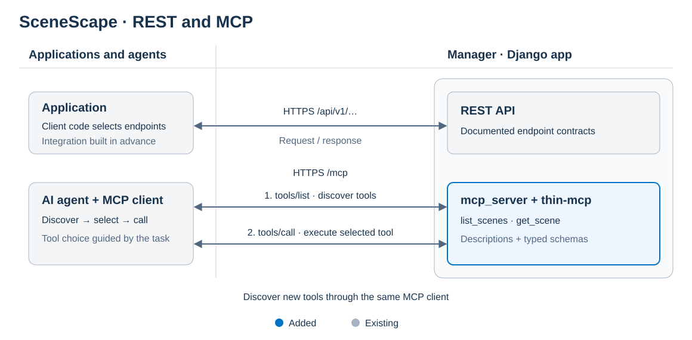

<!--
SPDX-FileCopyrightText: (C) 2026 Intel Corporation
SPDX-License-Identifier: Apache-2.0
-->

# Remote MCP

Manager provides a stateless JSON Streamable HTTP endpoint at
`https://web.scenescape.intel.com/mcp` (no trailing slash), implemented by the
`mcp_server` module and `thin-mcp==0.2.1`. It runs in the existing Python 3.11
Manager process. Rebuild the Manager image to install the dependency and include
the module; no database migrations or additional service is required.

## Architecture



The blue components are added by this integration. Manager's existing HTTPS
endpoint, API-token authentication, ORM models, and PostgreSQL database are reused.
The tools read configuration directly through the ORM; they do not call the REST
API or access live tracking state.

## Authentication and connection

Configure an MCP client with your deployment's HTTPS `/mcp` URL and an
`Authorization: Bearer <token>` header. The credential is an existing Manager
API token obtained through `/api/v1/auth`. The existing `Authorization: Token
<token>` scheme is also accepted. Session cookies are not accepted for MCP.

All active authenticated users have the same configuration read access as the
Manager REST API. This endpoint exposes only read operations; the API token
retains its existing permissions on other Manager endpoints. This initial
integration does not implement OAuth discovery or browser authorization, so
clients must support explicitly configured token headers.

For example, with `SCENESCAPE_API_TOKEN` set in your shell:

```bash
curl --fail-with-body https://web.scenescape.intel.com/mcp \
  --header "Authorization: Bearer ${SCENESCAPE_API_TOKEN}" \
  --header 'Content-Type: application/json' \
  --header 'Accept: application/json, text/event-stream' \
  --data '{"jsonrpc":"2.0","id":1,"method":"initialize","params":{"protocolVersion":"2025-11-25","capabilities":{},"clientInfo":{"name":"inventory-client","version":"1"}}}'

curl --fail-with-body https://web.scenescape.intel.com/mcp \
  --header "Authorization: Bearer ${SCENESCAPE_API_TOKEN}" \
  --header 'Content-Type: application/json' \
  --header 'Accept: application/json, text/event-stream' \
  --header 'MCP-Protocol-Version: 2025-11-25' \
  --data '{"jsonrpc":"2.0","id":2,"method":"tools/list"}'
```

Use a CA trusted by your client (or configure your deployment's CA explicitly).
The endpoint supports MCP revisions `2025-03-26`, `2025-06-18`, `2025-11-25`, and
`2026-07-28`, with header validation delegated to thin-mcp. It returns JSON
responses and HTTP 202 for notifications; it does not maintain sessions or offer
an SSE stream. GET and DELETE return HTTP 405.

## Tools

| Tool          | Arguments                | Result                                                 |
| ------------- | ------------------------ | ------------------------------------------------------ |
| `list_scenes` | `limit`, `offset`        | Scene ID, name, map type, scale, tracker configuration |
| `get_scene`   | Required `scene_id` UUID | One scene with the same summary fields                 |

Lists default to 25 items, with a hard maximum of 25. Results contain `items`
and `next_offset`; pass a non-null `next_offset` as the next request's `offset`.
Offsets must be between 0 and 100000. Pagination stops with `next_offset: null`
when the next page would exceed that offset limit, even if more records exist.
This bounds inventory traversal; it is not a complete export of larger datasets.
Pages have a stable identifier order;
configuration changes between requests may shift offset pagination. Unknown
arguments are rejected. A missing scene returns a tool execution error.

For example, call `list_scenes` with
`{"jsonrpc":"2.0","id":3,"method":"tools/call","params":{"name":"list_scenes","arguments":{"limit":10,"offset":0}}}`.

These tools return persisted configuration. They do not report live occupancy,
tracking state, video, or camera health. Stream URLs, credentials, files, raw
configuration blobs, and user records are excluded from results.

## Transport controls

Requests must contain one JSON-RPC object with `Content-Type: application/json`.
The Django setting `MCP_MAX_REQUEST_SIZE` sets the maximum body size in bytes
(default: `64 * 1024`, or 64 KiB). Batches are unsupported. Responses use
`Cache-Control: no-store`; unexpected failures return a generic error.
The adapter reads at most the configured limit plus one byte to detect oversized payloads.
HTTP failures (authentication, permissions, throttling, content type, request size,
and unsupported methods) use DRF-style `{"detail": "..."}` responses.
JSON parsing, MCP validation, and dispatch errors retain JSON-RPC error envelopes.

Requests without an Origin header are accepted. Browser origins must match the
request origin or an exact string in the Django setting `MCP_ALLOWED_ORIGINS`
(default: empty list). Configure additional origins only when required.
Django's existing `ALLOWED_HOSTS` validation also applies.

The Django setting `MCP_THROTTLE_RATE` defaults to `120/min` per user. Throttling
uses the configured Django cache and returns HTTP 429 with `Retry-After`. With
the default local-memory cache this limit applies separately to each worker;
use a shared cache for a shared limit.

## Development and verification

The endpoint in `api.py` uses DRF authentication, permission, throttle, and parser
hooks from `transport.py`. DRF selects the content type; the parser reads bounded
bytes, and `core.py` validates JSON and the MCP envelope in one Pydantic call
before thin-mcp dispatch. Bounded ORM projections live in `queries.py`, and typed adapters in
`tools/`. `tools_registry.py` owns the registry. Domain imports in
`tools/__init__.py` determine discovery order. Tools check active authentication
before executing queries and declare read-only annotations.

See the [module extension guide](../../manager/src/mcp_server/AGENTS.md) for how
to add a tool, its typed contract, permission checks, tests, and documentation.

Run the isolated tests without native geometry, a database, or Docker:

```bash
uv run --no-project --python 3.11 \
  --with-requirements manager/tests/mcp_server/requirements.txt \
  python -m pytest manager/tests/mcp_server -q
```

The tests use real Django/DRF HTTP handling and thin-mcp dispatch, with token
lookups and domain queries mocked. Import-path setup lives in the local
`conftest.py`. Pre-merge CI and All Tests run the isolated Python 3.11 suite via
`tests-mcp.yml`; see the [test guide](../../manager/tests/mcp_server/README.md).
To verify the deployed stack after rebuilding Manager, run the
authenticated initialization, discovery, and tool-call examples above against
your deployment.
